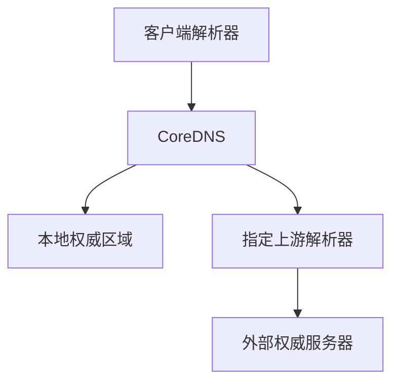
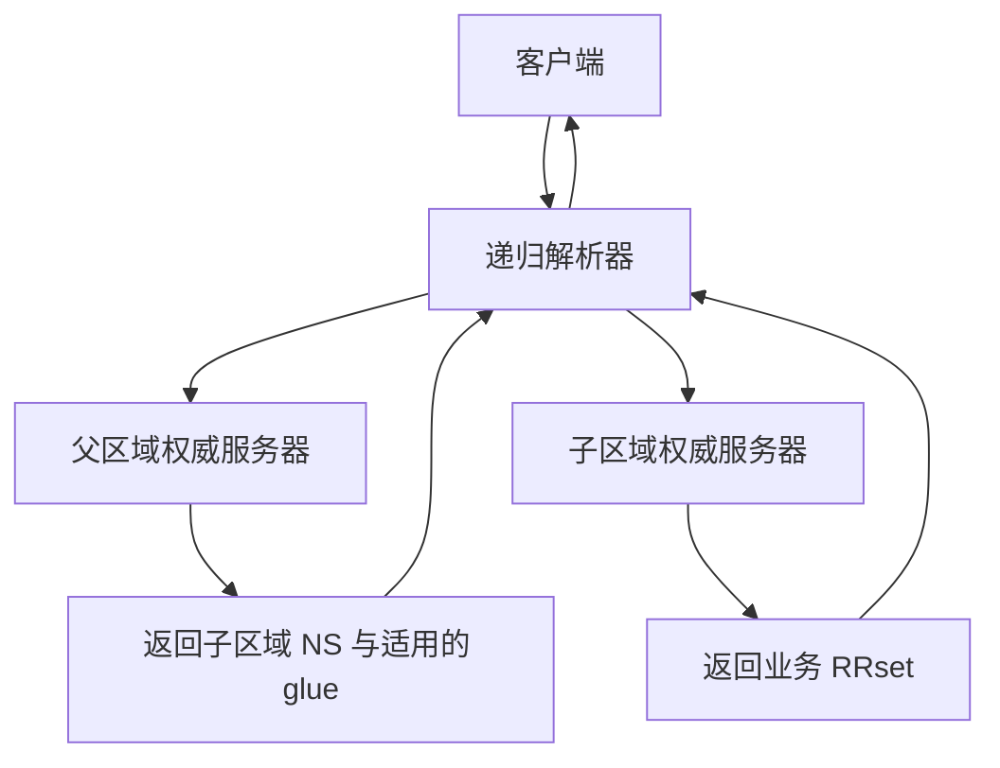
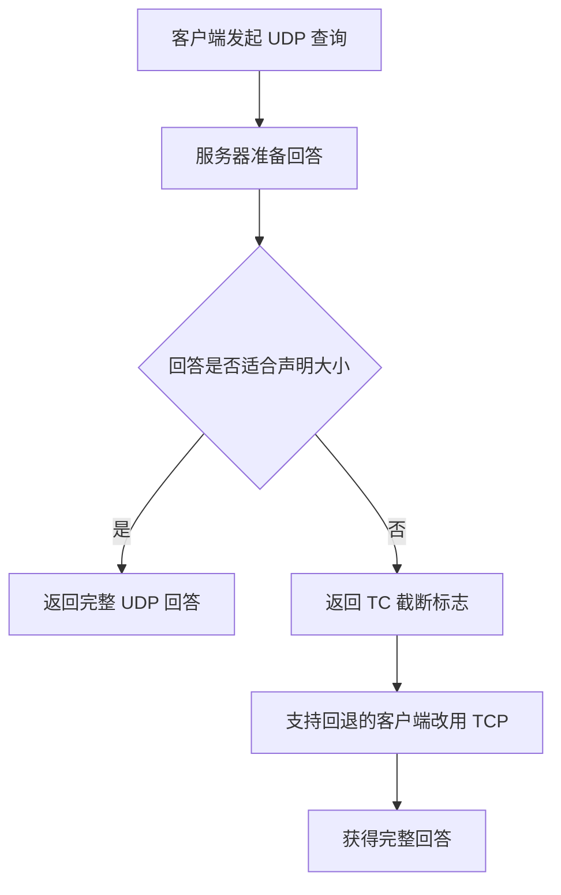
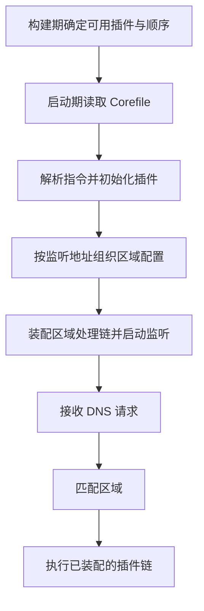
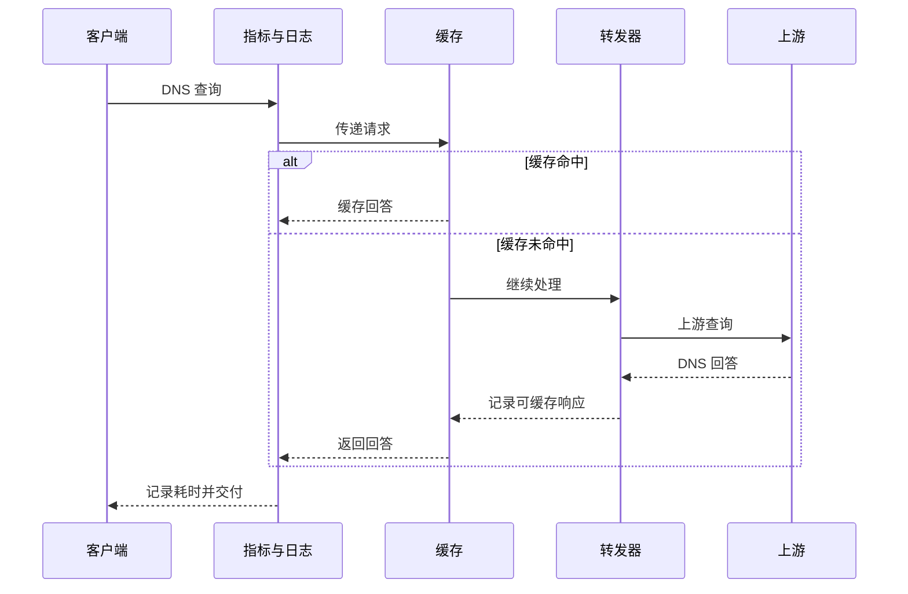
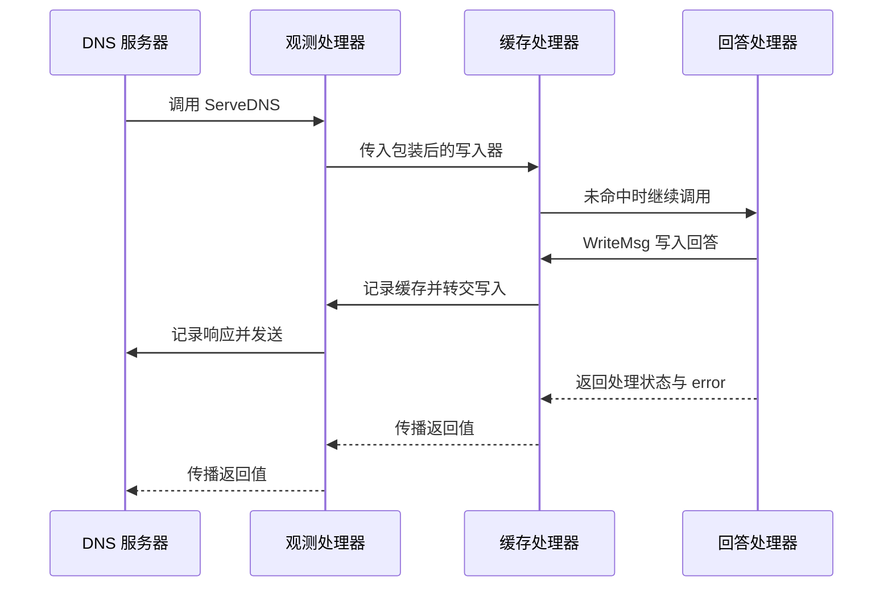

# CoreDNS 基础与请求处理 学习笔记

## 第 1 章 · 从 DNS 问题认识 CoreDNS

### 区分权威回答、递归解析与转发
<!-- src: https://coredns.io/manual/toc/; https://github.com/coredns/coredns/blob/v1.12.4/plugin/forward/README.md; https://github.com/coredns/coredns/blob/v1.12.4/plugin/file/README.md -->

CoreDNS 是以插件组合 DNS 功能的服务器。本系列面向运维、SRE 和平台工程师，先建立请求处理模型，再进入插件组合和集群实践。配置以 CoreDNS **v1.12.4** 为基线；这只是可复查的学习版本，不代表生产升级推荐。

#### 三种职责决定数据从哪里来

权威服务器负责某个区域的记录，例如从 Zone 文件读取 `api.example.test.` 的 A 记录。递归解析器替客户端沿 DNS 委派关系寻找最终答案，并可能缓存结果。转发器把请求交给另一个 DNS 服务器，后者可能承担递归解析。

`file` 使 CoreDNS 从本地区域文件回答；`forward` 把消息交给指定上游。不能因为配置了 `forward .`，就认为 CoreDNS 会自行从根服务器开始迭代查询。权威能力、转发能力与完整递归能力是不同的实现责任。



图中的两条分支是职责示意，实际选择由 Server Block、插件链和请求域名共同决定。缓存命中时，请求可能根本到不了后端。

#### 从需求反推配置选择

| 需求 | 起点 | 不能顺带假定的能力 |
| --- | --- | --- |
| 少量主机名映射 | `hosts` | 不支持任意 DNS 记录类型 |
| 完整区域记录 | `file` | 不自动管理公网域名委派 |
| 转交企业 DNS | `forward` | 不自动获得企业上游的访问权限 |
| Kubernetes 服务发现 | `kubernetes` | 不替代 Service 数据面转发 |

学习时对每个域名先写出“谁拥有数据，谁产生答案，谁负责缓存”。如果答案错误，应先确定记录的权威来源，再决定修改哪一份配置；在错误层加静态覆盖很容易掩盖真正的问题。

### 从域名树、区域委派与 RRset 理解数据归属
<!-- src: https://www.rfc-editor.org/rfc/rfc1034; https://www.rfc-editor.org/rfc/rfc2181; https://coredns.io/manual/toc/ -->

DNS 中的名字按标签组成树，例如 `api.dev.example.test.` 从根向下依次经过 test、example、dev、api。域是名称树上的一棵子树；Zone 则是某组权威服务器实际管理的数据范围。两者并不总是相同：父域可以把某个子域委派出去，自己保留委派信息，而由子区域负责其记录。

#### 委派决定下一步问谁，转发决定当前服务器交给谁

假设 `example.test` 将 `dev.example.test` 委派给另一组服务器。父区域保存子区域的 NS 信息；子区域有自己的 SOA、NS 和业务记录。父服务器可能返回 referral，让解析器继续询问子区域，而不是直接给出最终业务地址。



glue 是父方提供的用于寻找被委派服务器的地址信息。例如 NS 名称本身就在被委派的子域内，如果只能先问子域才能获得 NS 地址，就出现启动查询的循环依赖。glue 帮助解析器找到服务器，但不能把所有 ADDITIONAL 内容都当作经过验证的业务答案。

Corefile 里增加一个 `dev.example.test` 块，只改变到达这个 CoreDNS 实例的请求如何处理；它不会替你在父区域发布 NS 委派。类似地，`forward dev.example.test ...` 是当前解析服务的转发策略，并不改变公共 DNS 的区域所有权。[DNS 概念与设施](https://www.rfc-editor.org/rfc/rfc1034)

#### RRset 是同名同类同类型记录的集合

以下是一个 Zone 文件片段，两个 A 记录属于同一个 RRset，AAAA 属于另一个：

```text
api.example.test. 60 IN A    192.0.2.10
api.example.test. 60 IN A    192.0.2.11
api.example.test. 60 IN AAAA 2001:db8::10
```

RRset 不只是显示上的多行。相同 owner name、class、type 的记录应作为一组理解，TTL 应保持一致；地址顺序不应被当作主备优先级。CNAME 则表达名称别名，不能把同一名称普通 A 与 CNAME 随意混用。[RRset 与别名约束](https://www.rfc-editor.org/rfc/rfc2181)

#### 用查询区分区域配置与递归过程

完成第二篇的 `file` 实验后，可直接查询该区域的 SOA、NS 与业务记录：

```bash
dig @127.0.0.1 -p 1053 example.test. SOA +norecurse
dig @127.0.0.1 -p 1053 example.test. NS +norecurse
dig @127.0.0.1 -p 1053 api.example.test. A +norecurse
```

`+norecurse` 取消请求中的 RD，不表示“强迫任意服务器进行迭代解析”。本例直接访问已知权威端点。若要观察公网委派，可在允许直连外部 DNS 的网络运行 `dig +trace www.iana.org. A`；trace 由 dig 自己逐步查询，不等同于应用通过企业 DNS 的真实访问路径，也不会为本地 `.test` 实验自动建立父级委派。

遇到“直查 CoreDNS 成功，但其他机器查不到”时，应分别检查记录服务、客户端 nameserver、转发配置和父区域委派。四者对应不同责任，不能仅靠本地 A 查询成功就判定整个 DNS 名称已发布。

### 从响应报文判断解析结果
<!-- src: https://github.com/coredns/coredns/blob/v1.12.4/plugin/file/README.md; https://github.com/coredns/coredns/blob/v1.12.4/plugin/log/README.md -->

DNS 查询包含名称、类型和类别，例如 `api.example.test. IN A`。回答不能只看是否出现 IP：响应码、ANSWER、AUTHORITY、TTL 和标志共同表达处理结果。同一个名字查询 A 和 AAAA，可以得到不同的有效结果。

#### 读懂记录和状态

| 字段或类型 | 含义 | 判断方式 |
| --- | --- | --- |
| A / AAAA | IPv4 / IPv6 地址 | 与预期地址族分别核对 |
| CNAME | 别名指向另一名称 | 检查目标名称及后续解析 |
| SRV | 服务优先级、权重、端口、目标 | 不能按普通 IP 列表解读 |
| SOA / NS | 区域管理信息 / 权威服务器 | 用于理解区域责任与否定回答 |
| PTR | 地址反向映射 | 与正向记录分别验证 |
| `NOERROR` | 查询处理成功 | 可能有回答，也可能是 NODATA |
| `NXDOMAIN` | 查询名称不存在 | 不等同于网络不通 |
| `SERVFAIL` | 服务器未完成解析 | 继续检查后端、同步或配置 |
| `REFUSED` | 服务器拒绝处理 | 可能是策略，也可能是并发保护 |

NODATA 通常表现为 `NOERROR` 且没有所请求类型的记录；不能仅凭空 ANSWER 就下结论，还要排除 CNAME 链、委派等其他情况。`aa` 是响应中声明权威性的标志，不能单凭它定位实际数据源；`tc` 表示截断，`rd` 是客户端的递归期望，`ra` 表示服务器声明支持递归；这些标志也不直接证明应用连接成功。

#### 保存完整证据再精简输出

在下一章启动实验实例后运行：

```bash
dig @127.0.0.1 -p 1053 api.example.test. A +time=2 +tries=1
dig @127.0.0.1 -p 1053 api.example.test. AAAA +time=2 +tries=1
dig @127.0.0.1 -p 1053 api.example.test. A +noall +answer
```

第一条用于读取状态、服务器地址和耗时；最后一条适合快速查看记录，但会隐藏故障判断所需的上下文。DNS 超时通常是客户端没有及时拿到响应，并不是一种 DNS 响应码。排查时同时记录查询时间、客户端位置、目标服务器、名称、类型和传输协议，才能比较两次实验。

## 第 2 章 · 建立可重复的本地实验

### 启动固定版本并完成首次查询
<!-- src: https://github.com/coredns/coredns/releases/tag/v1.12.4; https://github.com/coredns/coredns/blob/v1.12.4/README.md; https://github.com/coredns/coredns/blob/v1.12.4/plugin/hosts/README.md; https://github.com/coredns/coredns/blob/v1.12.4/plugin/bind/README.md -->

先用一个完全本地的实例验证工具、配置和协议。下面从下载开始，安装到实验目录的 `bin/`，不覆盖系统二进制，不修改系统 DNS。首次下载需要联网；本地 hosts 查询本身不依赖公网 DNS。

#### 先准备工具并识别操作系统与架构

先执行 `uname -s`、`uname -m`，不要只凭机器品牌选择发行包。这里支持 Linux/macOS 的 amd64 与 arm64；在 Rosetta 或容器环境中，还需确认当前执行环境所需架构。其他平台与架构从 [v1.12.4 官方发行页](https://github.com/coredns/coredns/releases/tag/v1.12.4) 选择，不要照搬文件名。

```bash
uname -s
uname -m
command -v curl
command -v tar
command -v dig
command -v python3
```

Ubuntu/Debian 可用 `sudo apt-get update` 后执行 `sudo apt-get install ca-certificates curl tar dnsutils python3`；Fedora/RHEL 系可按发行版包源安装 `curl tar bind-utils python3`。macOS 通常已有 curl、tar 和 dig；缺少工具且已配置 Homebrew 时，可用 `brew install bind python` 补齐 dig 与 Python 3。包管理操作只在对应系统执行，先确认仓库与权限。

Python 3 用于后面的 EDNS 数据生成，不是 CoreDNS 二进制的运行依赖。安装步骤还会使用 macOS 的 `shasum` 或 Linux 的 `sha256sum`，缺少它们时应先补齐工具，不能跳过校验。

#### 下载、校验并安装到当前实验目录

在一个用于学习的工作目录执行以下命令。子 Shell 中启用失败即停止，避免下载或校验失败后继续解压；再次执行会覆盖实验目录内同版本文件。

```bash
mkdir -p coredns-lab
cd coredns-lab
(
    set -eu
    dns_version='1.12.4'
    case "$(uname -s)" in
        Linux) dns_os='linux' ;;
        Darwin) dns_os='darwin' ;;
        *) echo '请从官方发行页选择适用平台' >&2; exit 1 ;;
    esac
    case "$(uname -m)" in
        x86_64|amd64) dns_arch='amd64' ;;
        arm64|aarch64) dns_arch='arm64' ;;
        *) echo '此示例未覆盖该架构' >&2; exit 1 ;;
    esac
    dns_archive="coredns_${dns_version}_${dns_os}_${dns_arch}.tgz"
    dns_release="https://github.com/coredns/coredns/releases/download/v${dns_version}"
    mkdir -p downloads bin
    curl -fL --retry 2 "$dns_release/$dns_archive" -o "downloads/$dns_archive"
    curl -fL --retry 2 "$dns_release/$dns_archive.sha256" -o "downloads/$dns_archive.sha256"
    dns_expected=$(awk 'NR == 1 {print $1}' "downloads/$dns_archive.sha256")
    if [ "$dns_os" = darwin ]; then
        dns_actual=$(shasum -a 256 "downloads/$dns_archive" | awk '{print $1}')
    else
        dns_actual=$(sha256sum "downloads/$dns_archive" | awk '{print $1}')
    fi
    if [ -z "$dns_expected" ] || [ "$dns_actual" != "$dns_expected" ]; then
        echo 'SHA-256 不匹配 停止安装' >&2
        exit 1
    fi
    tar -xzf "downloads/$dns_archive" -C bin coredns
    chmod u+x bin/coredns
    ./bin/coredns -version
)
```

确认上一步成功且打印 `CoreDNS-1.12.4` 后，再设置**当前终端**的 PATH：

```bash
export PATH="$PWD/bin:$PATH"
command -v coredns
coredns -version
coredns -plugins
```

`command -v` 应指向当前 `coredns-lab/bin/coredns`，而非另一份系统安装。新终端不会自动继承这个 PATH；可重新设置，或用完整路径运行。SHA-256 比对检验下载文件与官方校验文件一致，不等于独立的发布者签名验证。

#### 使用独立目录和非特权端口

以下命令继续在刚才的 `coredns-lab` 目录执行，不要再次进入同名子目录：

```bash
cat > Corefile <<'COREFILE'
example.test:1053 {
    bind 127.0.0.1
    errors
    log
    hosts /dev/null example.test {
        192.0.2.10 api.example.test
        ttl 30
    }
}
COREFILE
coredns -conf Corefile
```

`/dev/null` 用于避免意外读取宿主机 `/etc/hosts`；此例面向 macOS/Linux。`192.0.2.10` 是文档示例地址，只用于检查 DNS 回答，不代表存在可连接的业务服务。`bind` 限制为本机回环接口，`1053` 避开系统 53 端口。

另开一个终端执行：

```bash
dig @127.0.0.1 -p 1053 api.example.test. A +noall +answer
```

预期 ANSWER 包含 `api.example.test.` 和 `192.0.2.10`，TTL 为 30。此处“预期”是实验判据，执行记录见主题 README 的验证边界，不能把示例当成某个生产环境的实测输出。

#### 区分启动失败与查询失败

若没有监听成功，先看前台错误：未知指令常指向版本或拼写，端口占用指向其他进程，文件找不到指向工作目录或挂载路径。若已启动但超时，检查是否查询了正确端口和地址，不要先改上游，因为本例没有上游。

在运行终端按 Ctrl-C 停止实例。每次替换 Corefile 后重新启动，直到学到 `reload` 再使用热加载；这样不会把“改了文件但旧配置还在运行”混入基础实验。

### 用 UDP、TCP 与查询类型建立验证矩阵
<!-- src: https://github.com/coredns/coredns/blob/v1.12.4/plugin/hosts/README.md; https://github.com/coredns/coredns/blob/v1.12.4/plugin/whoami/README.md -->

DNS 服务应按所需协议分别验证。普通 `dig` 默认使用 UDP，而 `+tcp` 强制 TCP；UDP 查询成功不能证明 TCP 监听、转发或网络策略正常。大回答、截断重试等场景尤其需要 TCP 链路。

#### 一次只改变一个条件

沿用上一节的本地 Corefile：

```bash
dig @127.0.0.1 -p 1053 api.example.test. A +time=2 +tries=1
dig @127.0.0.1 -p 1053 api.example.test. A +tcp +time=2 +tries=1
dig @127.0.0.1 -p 1053 api.example.test. AAAA +time=2 +tries=1
dig @127.0.0.1 -p 1053 absent.example.test. A +time=2 +tries=1
```

前两条应返回相同的 A 地址，日志中的传输协议不同。第三条没有可配置的 IPv6 地址；第四条没有对应主机记录。后两条用于观察插件未命中的具体行为，不应预设所有数据插件都会返回同一种否定响应。`hosts` 不是完整权威区域服务器，需要严格验证 NXDOMAIN/NODATA 时使用第二篇的 `file` 实验。

| 变量 | 保持不变 | 要记录的证据 |
| --- | --- | --- |
| UDP 改为 TCP | 域名与类型 | 是否握手、响应码、ANSWER |
| A 改为 AAAA | 名称与服务器 | 是否存在对应地址族记录 |
| 已知名称改为未知名称 | 类型与服务器 | 未命中后的终止或传递行为 |

#### 让工具结论停留在它能证明的范围

`dig @服务器` 绕过应用自己的解析入口，因此能证明该 DNS 端点对指定请求的回答，却不能证明浏览器、JVM 或系统解析器会走同一条路径。`whoami` 可用于观察服务器看到的客户端地址、端口与协议，但经过 NAT 或节点缓存后，这个地址也可能不再是原始客户端。

完成矩阵后，再用真实应用的解析调用复测。DNS 成功、TCP 连接成功、TLS 验证成功和业务 HTTP 成功是四个不同的验收层次。

### 用 EDNS 与截断实验理解 TCP 回退
<!-- src: https://www.rfc-editor.org/rfc/rfc6891; https://bind9.readthedocs.io/en/v9.18.39/manpages.html#dig-dns-lookup-utility; https://github.com/coredns/coredns/blob/v1.12.4/plugin/file/README.md; https://github.com/coredns/coredns/blob/v1.12.4/plugin/forward/README.md -->

小型 A 记录查询成功，不代表较大的 DNS 回答也能到达客户端。传统未扩展 DNS 的 UDP 消息上限是 512 字节；EDNS(0) 通过 OPT 伪记录让请求方声明可接收的 UDP 消息大小。这里讨论的是 DNS 消息大小，不包含 IP/UDP 头，也不等于路径 MTU。

#### 区分截断、丢包与协议回退

服务器无法在允许大小内返回完整数据时，可设置 `TC` 标志。`dig` 默认收到截断回答后会尝试 TCP；`+ignore` 保留截断的 UDP 回答而不自动回退，适合取证。`+tcp` 则从一开始使用 TCP，不证明此前发生过 UDP 截断。

EDNS 是逐跳协商：客户端到 CoreDNS 与 CoreDNS 到上游是两段交换。调大客户端的缓冲声明，并不能保证所有链路都支持相同报文大小；超过实际路径承载能力的大 UDP 包还可能分片或丢失。静默丢包不一定让客户端收到 TC，不能期待所有 UDP 超时都会自动转 TCP。



#### 构造超过 512 字节但小于 1232 字节的本地回答

先停止前一节实例。本实验需要 Python 3，在独立目录生成一个仅用于学习的 Zone；其中十条 TXT 属于同一个 RRset，内容编号不同，不会被当作重复记录去掉。

```bash
mkdir -p edns-lab
cd edns-lab
python3 - <<'PY'
from pathlib import Path
records = [
    '$ORIGIN example.test.',
    '$TTL 60',
    '@ IN SOA ns.example.test. hostmaster.example.test. 1 3600 600 86400 30',
    '@ IN NS ns.example.test.',
    'ns IN A 192.0.2.53',
]
for i in range(10):
    payload = f'{i:02d}-' + 'x' * 77
    records.append(f'large IN TXT "{payload}"')
Path('db.example.test').write_text('\n'.join(records) + '\n')
PY
cat > Corefile <<'COREFILE'
example.test:1053 {
    bind 127.0.0.1
    errors
    log
    file db.example.test example.test
}
COREFILE
coredns -conf Corefile
```

本节只借用 `file` 提供确定的记录数据，区域文件与 SOA 的详细机制见第二篇。另开终端执行以下对照，每次只改变协议或 EDNS 选项：

```bash
# 禁用 EDNS 并关闭自动 TCP 回退 保留原始截断证据
dig @127.0.0.1 -p 1053 large.example.test. TXT +noedns +notcp +ignore
# 声明 512 字节 EDNS 缓冲 同样观察截断
dig @127.0.0.1 -p 1053 large.example.test. TXT +edns=0 +bufsize=512 +notcp +ignore
# 允许更大的 UDP 回答
dig @127.0.0.1 -p 1053 large.example.test. TXT +edns=0 +bufsize=1232 +notcp +ignore
# 允许 dig 在收到 TC 后自动使用 TCP 重试
dig @127.0.0.1 -p 1053 large.example.test. TXT +noedns +notcp +noignore
# 直接走 TCP 作为完整回答对照
dig @127.0.0.1 -p 1053 large.example.test. TXT +tcp
```

前两条应能看到 `tc`，不能把其 ANSWER 当作完整数据集；第三条应在 UDP 下拿到十条 TXT 且没有 `tc`。第四条应提示截断后重试，服务端日志可观察先 udp、后 tcp；第五条直接以 TCP 返回十条 TXT。`OPT PSEUDOSECTION` 中的 `udp` 数值表示 EDNS 缓冲信息，不是当前请求一定使用 UDP 的证据，协议判断应结合命令和服务端日志。

#### 将实验结论带回真实网络

| 对照现象 | 更合理的下一步 | 不应直接推出 |
| --- | --- | --- |
| 小回答成功，大回答 UDP 失败 | 检查报文大小、分片和网络策略 | 域名记录必然错误 |
| 已收到 TC，但 TCP 重试失败 | 检查到该 DNS 端点的 TCP 53 | 只需放通 UDP 53 |
| UDP 静默超时，TCP 成功 | 对比路径丢包与客户端回退策略 | 服务端一定发过 TC |
| 直查上游正常，经 CoreDNS 异常 | 分别检查两段交换与 forward 配置 | 客户端 EDNS 值控制所有跳 |

1232 在这里是刻意选定的实验缓冲值，不是对所有网络的最优值承诺。`forward force_tcp` 控制到上游的传输；`prefer_udp` 的截断重试属于转发器一侧，与本实验的 dig 回退不是同一环节。不要用全局强制 TCP 代替定位问题。

实验结束后在服务终端按 Ctrl-C 停止进程。以上测试只覆盖本地协议行为，不制造或证明真实网络的 MTU、分片与防火墙故障。

## 第 3 章 · 读懂 Corefile 与域名路由

### 区分启动装配、监听器与逐请求路由
<!-- src: https://github.com/coredns/coredns/blob/v1.12.4/core/dnsserver/register.go; https://github.com/coredns/coredns/blob/v1.12.4/core/dnsserver/server.go; https://github.com/coredns/coredns/blob/v1.12.4/plugin.cfg; https://github.com/coredns/coredns/blob/v1.12.4/plugin/hosts/setup.go -->

Corefile 是声明配置，不是每次查询都从第一行执行的脚本。启动时，已经编译进二进制的指令被解析，插件完成初始化并连接成处理链；运行时，服务器接收 DNS 消息，选定对应区域，再调用已经建立的处理链。

#### 把构建期、启动期与查询期分开



这是一张生命周期关系图，不代表所有初始化回调都严格串行完成。某些插件还有后台同步、健康检查等任务；端口监听成功，不等于其后端数据已经同步完成。

在 v1.12.4 中，可沿 `register.go` 的配置分组和 `server.go` 的 `NewServer` 查看装配入口。插件通过 `AddPlugin` 提供处理器构造函数，服务器从链尾向前装配，使运行时可以从链首逐个调用。构造链的方向和请求执行的方向要区分。[服务器装配源码](https://github.com/coredns/coredns/blob/v1.12.4/core/dnsserver/server.go)

#### 一个 Server Block 不一定独占一个 socket

多个区域可以共享兼容的监听地址，由同一入口按查询名称分派；不同区域仍有对应的处理配置。相反，不同端口、协议或绑定地址可能需要不同监听器。不能把“两个块”直接等同于“两个进程”或“两个独立监听端口”。

| 对象 | 生命周期或职责 | 常见误解 |
| --- | --- | --- |
| CoreDNS 进程 | 承载监听、插件与后台任务 | 每个区域启动一个进程 |
| 监听器 | 接收特定协议和地址的流量 | 一个块必须独占一个监听器 |
| 区域配置与处理链 | 决定匹配后的处理方式 | 共享端口就共享全部配置 |
| 单次请求 | 携带名称、类型等查询信息 | 每次都重新解析 Corefile |

运行后面的“双 Server Block、同为 1053 端口”示例，用 `dig` 分别查询两个区域，并观察进程启动输出与各自答案。再给一块增加只属于它的日志或记录，验证共享入口没有让两块策略自动合并。

如果出现未知指令，应先查构建能力和配置解析；若端口冲突，应查监听层；若某域失败而其他域正常，应优先查区域与处理链。这种分层比反复调整插件书写顺序更能缩小范围。

### 用 Server Block 划分解析责任
<!-- src: https://coredns.io/manual/toc/; https://github.com/coredns/coredns/blob/v1.12.4/plugin/bind/README.md -->

Corefile 由一个或多个 Server Block 组成。每块声明要处理的 Zone、监听端口和插件。对于同一监听上下文中的请求，CoreDNS 按最具体的域名后缀选择匹配区域；`example.test` 比根区域 `.` 更具体。

#### 观察特定区域与兜底区域

用下面配置替换前一实验文件，重启实例：

```text
example.test:1053 {
    bind 127.0.0.1
    hosts /dev/null example.test {
        192.0.2.10 api.example.test
    }
}
.:1053 {
    bind 127.0.0.1
    template IN ANY {
        rcode REFUSED
    }
}
```

```bash
dig @127.0.0.1 -p 1053 api.example.test. A
dig @127.0.0.1 -p 1053 outside.test. A
```

第一条由特定区域处理，第二条应由根区域返回 REFUSED。选中某个 Server Block 后，里面的插件失败并不意味着 CoreDNS 自动退回另一个更宽泛的 Server Block；责任边界已经确定。

#### 注意监听地址的一致性

同端口多个块使用 `bind` 时应保持一致的绑定策略。一个块绑定 `127.0.0.1`、另一个使用默认通配监听，可能创建相互争抢流量的监听器，结果难以预测。实验中每块都显式绑定回环地址。

显式写出的 `:1053` 优先于 `-dns.port` 默认端口设置。生产迁移时应把 Zone、端口、协议、绑定地址作为一组检查，而不是只核对域名文本。可以新增一个更具体的 `dev.example.test` 块，分别查询父域和子域，验证最长后缀匹配。

### 用 import 管理配置并识别生效边界
<!-- src: https://github.com/coredns/coredns/blob/v1.12.4/plugin/import/README.md; https://github.com/coredns/coredns/blob/v1.12.4/plugin/reload/README.md; https://github.com/coredns/coredns/blob/v1.12.4/plugin/file/README.md; https://github.com/coredns/coredns/blob/v1.12.4/plugin/hosts/README.md -->

`import` 在解析配置时把文件或片段展开到当前位置，适合复用日志等公共设置。它不是查询时执行的插件，不会因为请求到来才去读取配置文件。文件路径相对 Corefile 所在位置解析；具体文件不存在会报错，匹配不到文件的 glob 则可能没有报错。

#### 把复用范围保持得足够小

```text
(observe) {
    errors
    log
}
example.test:1053 {
    bind 127.0.0.1
    import observe
    hosts /dev/null example.test {
        192.0.2.10 api.example.test
    }
    reload
}
```

复用片段适合减少重复，但把所有解析策略藏进多层 import 会增加排查成本。审核配置时应能回答“这个 Server Block 展开后启用了什么”。挂载文件也需要与配置一起交付，否则本地可用不代表容器内可用。

#### 不同文件由不同机制更新

| 被修改内容 | 对应机制 | 验证重点 |
| --- | --- | --- |
| Corefile 与导入文件 | `reload` | 成功重载日志与实际查询 |
| `hosts` 外部数据文件 | `hosts` 自身周期扫描 | 记录变化与加载时间 |
| `file` 区域文件 | `file` 检查 SOA serial | serial 更新与权威回答 |
| Kubernetes ConfigMap 投影 | kubelet 挂载更新，再到 `reload` | 文件投影和进程生效两个阶段 |

v1.12.4 的 `reload` 能发现导入文件变化，但仍需要等待检测周期。环境变量如 `{$UPSTREAM}` 属于配置解析输入，修改另一个终端的环境不会改变现有进程环境。验证变更时，应检查最终回答和重载日志，而不是只检查磁盘文件内容。

## 第 4 章 · 理解插件链的请求与响应

### 区分配置顺序与插件执行顺序
<!-- src: https://coredns.io/manual/toc/; https://github.com/coredns/coredns/blob/v1.12.4/plugin.cfg; https://github.com/coredns/coredns/blob/v1.12.4/plugin/forward/README.md -->

选定 Server Block 后，请求沿该块启用的插件链处理。不同插件的相对顺序来自构建时的 `plugin.cfg`，不是 Corefile 的行顺序。配置中把 `cache` 放在 `forward` 下方，并不表示缓存只能在转发完成后才接触请求。

#### 请求向下传递，响应可能被包装观察

下面是选定插件的简化链路，不代表完整默认插件列表：



日志、指标和缓存可以通过包装响应写入器观察后续插件的回答。没有真正产生 DNS 答案的插件，也可能影响可见性或性能。`health`、`bind` 等则不属于同一种逐请求数据处理逻辑。

#### 一个需要单独记住的顺序例外

同一 Server Block 中多条 `forward` 按它们在配置中的顺序匹配。因此下面更具体的域必须放前面：

```text
forward dev.example.test 192.0.2.53
forward example.test 192.0.2.54
forward . 192.0.2.55
```

这些地址只是上游占位，不能直接作为可用 DNS 实验。不同插件的编译顺序，与同一插件多个实例的配置语义，要分别判断。练习时可调换 `log` 与 `hosts` 的书写位置，观察行为仍相同；再在第二篇的本地上游实验里调换两条 `forward`，观察路由改变。

### 区分处理器返回值与写回客户端的 DNS 消息
<!-- src: https://github.com/coredns/coredns/blob/v1.12.4/plugin/plugin.go; https://github.com/coredns/coredns/blob/v1.12.4/plugin/cache/cache.go; https://github.com/coredns/coredns/blob/v1.12.4/plugin/forward/forward.go; https://github.com/coredns/coredns/blob/v1.12.4/core/dnsserver/server.go -->

插件链不只是函数逐个接收查询再返回一个 IP。处理器可以直接写 DNS 回答，也可以把请求交给下一个处理器；观测插件还可以包装响应写入器，让后续产生的回答先经过自己的记录逻辑。

#### 一次调用有两条需要区分的通道

`ServeDNS` 的接口包含请求上下文、响应写入器和请求消息，返回的是整数状态与 Go error：

```go
ServeDNS(context.Context, dns.ResponseWriter, *dns.Msg) (int, error)
```

这行是接口签名，不是可以单独运行的程序。真正发送给客户端的 DNS 数据来自响应消息及 `WriteMsg` 等写入操作；函数的返回值还承担插件与服务器之间的处理状态约定。不能只看到 `return 0, nil` 就断言客户端收到了 NOERROR。

例如 v1.12.4 的 forward 在收到一个可接受的上游回答后，会把该消息写回，然后返回 `0, nil`；消息本身可以携带 NXDOMAIN 等响应码。错误路径也可能返回 SERVFAIL/REFUSED 等状态，由服务器按约定生成回答。[处理器契约](https://github.com/coredns/coredns/blob/v1.12.4/plugin/plugin.go)



图示为简化的同步未命中路径，不包含预取后台刷新。缓存命中时可以直接写答案，后端处理器不会执行；客户端总能收到回答，不代表所有插件都看到了该请求。

#### 用“前端请求增加、后端请求不增加”验证短路

在第二篇的前端缓存和本地上游实验中，对同一名称连续查询。前端日志与请求指标应继续增加，上游查询量在缓存有效期内可保持不变。这证明处理链在缓存处结束了后端访问，而非客户端没有发请求。

再让上游对一个未缓存名称返回 NXDOMAIN，比较完整 `dig` 回答与前端响应码指标，确认最终协议状态。只看 `errors` 日志可能看不到这次有效的否定回答，因为协议层的否定结果不必伴随 Go error。

这也说明为什么统计范围必须明确：入口请求数、缓存请求数、转发交换数和上游业务成功数不是同一件事。读指标前先问它位于链路哪一层、缓存命中是否会经过它，再判断计数不一致是否异常。

### 掌握 fallthrough 与终止回答的边界
<!-- src: https://coredns.io/manual/toc/; https://github.com/coredns/coredns/blob/v1.12.4/plugin/hosts/README.md; https://github.com/coredns/coredns/blob/v1.12.4/plugin/template/README.md; https://github.com/coredns/coredns/blob/v1.12.4/plugin/kubernetes/README.md -->

`fallthrough` 让支持它的插件在特定未命中条件下继续调用后续插件。它不是所有插件通用的“失败重试”，也不等同于转发器切换上游。是否支持、何时触发、能否限制 Zone，都必须读对应插件文档。

#### 区分三种后续动作

| 动作 | 发生位置 | 典型例子 |
| --- | --- | --- |
| 继续插件链 | 当前 Server Block | `hosts` 未命中后 `fallthrough` |
| 切换转发上游 | 一个 `forward` 实例内部 | 与上游交换出现网络错误 |
| 选择另一个区域 | 进入插件链之前 | 最长后缀匹配 Server Block |

下面配置中，已知地址由 `hosts` 回答，未知名称继续到 `whoami`：

```text
.:1053 {
    bind 127.0.0.1
    hosts /dev/null {
        192.0.2.10 api.example.test
        fallthrough
    }
    whoami
}
```

```bash
dig @127.0.0.1 -p 1053 api.example.test. A
dig @127.0.0.1 -p 1053 missing.example.test. A
```

第二条需要查看完整报文，`whoami` 的诊断信息不能当成普通业务 A 记录。去掉 `fallthrough` 后重启再查，比较未命中行为，并在笔记里记下响应码及报文差异。

#### 域名边界比“总能查到”更重要

Kubernetes 常见配置只对 `in-addr.arpa`、`ip6.arpa` 开启回落，让插件无法回答的反向查询交给后续插件。若对整个集群域启用回落，不存在的内部名称可能被发送到外部上游，改变错误语义和数据边界。

同样，`template` 的 Zone 匹配但正则不匹配时，未配置 `fallthrough` 可返回 SERVFAIL。不能凭“没有命中我的规则”推断“一定会继续向下”。编写配置时必须同时设计命中与未命中两条路径。

## 第 5 章 · 从最小配置走向可维护服务

### 分清进程健康、插件就绪与业务可用
<!-- src: https://github.com/coredns/coredns/blob/v1.12.4/plugin/health/README.md; https://github.com/coredns/coredns/blob/v1.12.4/plugin/ready/README.md; https://github.com/coredns/coredns/blob/v1.12.4/plugin/kubernetes/README.md -->

进程活着、对象同步完成、指定域名可解析，分别回答不同问题。`health` 提供进程级 HTTP 健康端点；`ready` 汇总支持就绪接口的插件状态；两者都不能替代端到端 DNS 查询。

#### 显式暴露本地管理端点

```text
example.test:1053 {
    bind 127.0.0.1
    health 127.0.0.1:18080 {
        lameduck 5s
    }
    ready 127.0.0.1:18181
    hosts /dev/null example.test {
        192.0.2.10 api.example.test
    }
}
```

```bash
curl -i http://127.0.0.1:18080/health
curl -i http://127.0.0.1:18181/ready
dig @127.0.0.1 -p 1053 api.example.test. A
```

此例没有 Kubernetes 对象同步过程，`ready` 返回成功不能证明连接过 API Server。实际集群中 `kubernetes` 插件在初始同步完成后报告就绪；默认 `until-ready` 模式不会持续反复查询已经就绪的插件。即使配置 `monitor continuously`，也只能反映插件实现的就绪定义，不能推断每个上游都可用。

#### 退出时理解探针与流量摘除

v1.12.4 的 `health lameduck 5s` 会延迟退出，此期间 `/health` 仍返回 200，而 `/ready` 不再报告就绪。本地验证中 `/ready` 的监听在退出阶段关闭，因此不能承诺它总是返回固定的 HTTP 503。这个差异允许编排系统先摘流量，再终止进程。真实效果还取决于探针周期、端点更新和终止宽限时间。

验收应同时检查端点状态与 DNS 查询。不要把上游业务故障简单映射为进程不健康，否则大量重启可能进一步丢失缓存并加重上游压力。

### 核对插件能力并形成学习实验记录
<!-- src: https://github.com/coredns/coredns/blob/v1.12.4/README.md; https://github.com/coredns/coredns/blob/v1.12.4/plugin.cfg -->

Corefile 只能启用当前二进制已编译的插件。官网能找到某个插件文档，并不代表手上的发行包包含它；第三方镜像还可能带有不同构建。外部插件通常需要重新构建二进制，不能把源码目录放到旁边就当作动态加载。

#### 记录可复现的运行输入

```bash
coredns -version
coredns -plugins
shasum -a 256 Corefile
```

| 记录项 | 示例内容 | 作用 |
| --- | --- | --- |
| 二进制版本与来源 | v1.12.4 官方发行包 | 对齐插件语法 |
| 配置与附属文件 | Corefile、hosts、Zone | 避免只保存主文件 |
| 网络位置 | 本机回环、Pod、节点 | 解释路径差异 |
| 请求 | 服务器、端口、名称、类型、协议 | 使故障可重现 |
| 判据 | 预期 RCODE、记录、TTL 范围 | 防止只看退出码 |
| 实际结果 | 原始报文和时间 | 保留证据边界 |

散列只能标识文件内容是否变化，不能证明语义正确。`-plugins` 能说明构建能力，也不能证明某个插件在当前 Server Block 已启用。

#### 用问题串起后续学习

完成本篇后，应能解释：请求选择了哪个区域，哪些插件可能回答，未命中后走到哪里，哪个配置决定记录来源。第二篇把这些机制组合成转发、缓存和规则实验；第三篇把后端换成 Kubernetes 对象；第四篇用观测和故障实验验证这些判断。

每次实验只引入一个新变量。发现实际行为和预期不一致时，保留输入和输出，回到固定版本文档与源码核对；不要为了让演示成功同时修改域名、上游、缓存和网络策略，否则无法确定是哪一项起作用。
