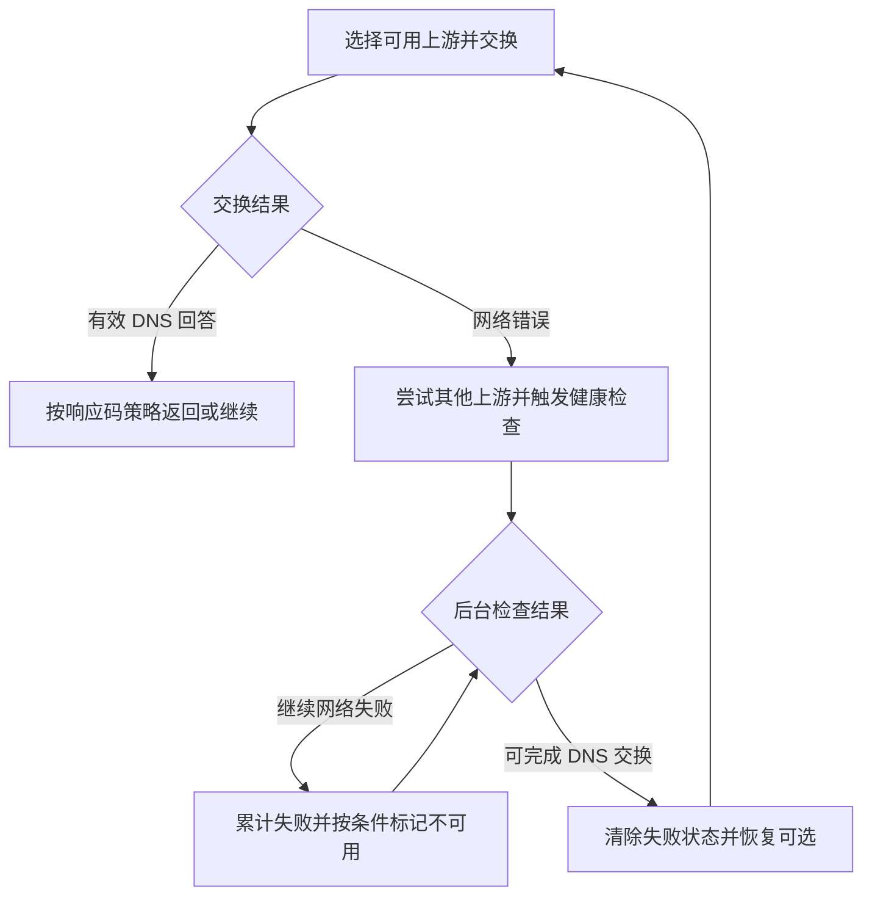
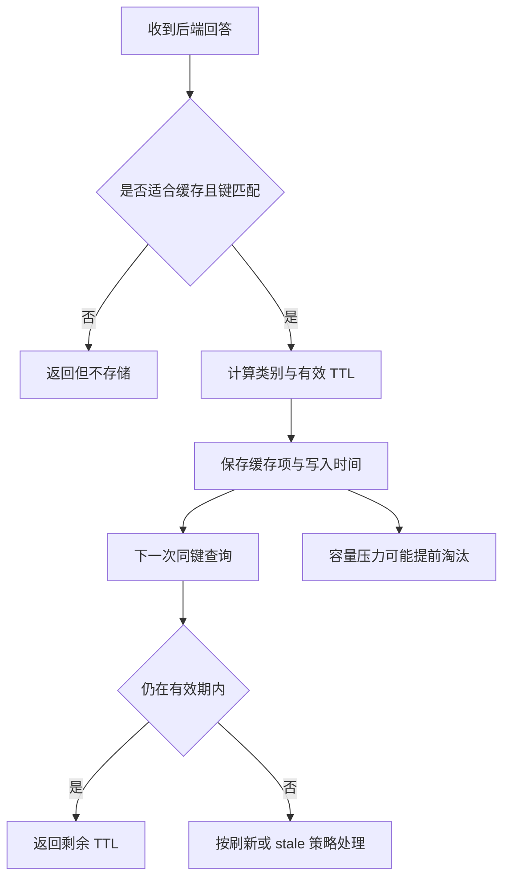
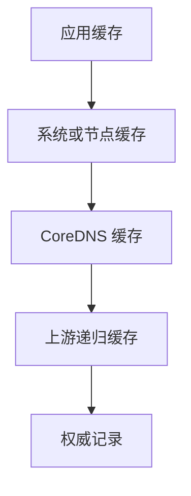

# CoreDNS 核心插件与场景组合 学习笔记

## 第 1 章 · 管理静态记录与权威区域

### 用 hosts 管理少量地址映射
<!-- src: https://github.com/coredns/coredns/blob/v1.12.4/plugin/hosts/README.md -->

本篇以 CoreDNS v1.12.4 为基线，假设已准备 `coredns`、`dig` 和独立实验目录。每个完整 Corefile 默认是独立实验，需要停止前一个占用 1053 的实例再启动。未标为完整文件的片段应放入指定 Server Block，不能直接作为整个 Corefile。

`hosts` 适合少量固定地址、实验覆盖或临时迁移。数据模型只有地址与主机名映射，支持 A、AAAA 和自动生成的 PTR，不适合表达 MX、SRV、SOA 或完整区域委派。

#### 从外部文件加载并观察变化

```bash
cat > lab.hosts <<'HOSTS'
192.0.2.10 api.example.test
2001:db8::10 api.example.test
HOSTS
cat > Corefile <<'COREFILE'
.:1053 {
    bind 127.0.0.1
    errors
    hosts lab.hosts {
        ttl 30
        reload 2s
    }
}
COREFILE
coredns -conf Corefile
```

另一个终端在同目录查询：

```bash
dig @127.0.0.1 -p 1053 api.example.test. A
dig @127.0.0.1 -p 1053 api.example.test. AAAA
dig @127.0.0.1 -p 1053 -x 192.0.2.10
```

PTR 自动生成；若不希望暴露反向映射，可用 `no_reverse`。修改文件中的地址并等待扫描周期后再查。此处没有 `cache`，`dig` 直接向实例发请求，因此适合隔离数据文件更新机制；经系统缓存或其他转发器查询时结果可能滞后。

#### 覆盖范围与退出条件

默认扫描周期为 5 秒，本例改为 2 秒。内联 hosts 与文件一起使用时，内联条目可以覆盖文件条目；运维时必须同时检查两处来源。配置 `fallthrough` 才能在适用的未命中情况下交给后续插件。

生产临时覆盖应记录负责人、原始数据源和撤销条件。长时间用 hosts 掩盖后端错误，会把权威数据和实际回答分离。若记录需要表达多个类型、否定回答或 SOA serial，应升级为区域文件管理。

### 用 file 表达完整 Zone 并验证更新
<!-- src: https://github.com/coredns/coredns/blob/v1.12.4/plugin/file/README.md -->

`file` 从 RFC 1035 风格区域文件生成权威回答。区域文件有明确的 origin、SOA 和资源记录，适合用一个实验同时理解正向记录、别名和否定响应。它服务本地记录，不会自动完成公网域名的上级委派。

#### 建立一个可控区域

```bash
cat > db.example.test <<'ZONE'
$ORIGIN example.test.
$TTL 60
@ IN SOA ns.example.test. hostmaster.example.test. (
    2026102001 3600 600 86400 30 )
  IN NS ns.example.test.
ns IN A 192.0.2.53
api IN A 192.0.2.10
www IN CNAME api.example.test.
_svc._tcp IN SRV 0 10 8080 api.example.test.
ZONE
cat > Corefile <<'COREFILE'
example.test:1053 {
    bind 127.0.0.1
    errors
    log
    file db.example.test example.test {
        reload 2s
    }
}
COREFILE
coredns -conf Corefile
```

SOA 中的邮箱用域名形式表示，`hostmaster.example.test.` 对应管理邮箱。记录中的尾点表示完整名称；遗漏尾点可能让 origin 再次追加，产生意外名称。`$TTL 60` 是未显式指定 TTL 时的默认值，不是缓存容量。

```bash
dig @127.0.0.1 -p 1053 api.example.test. A
dig @127.0.0.1 -p 1053 www.example.test. A
dig @127.0.0.1 -p 1053 _svc._tcp.example.test. SRV
dig @127.0.0.1 -p 1053 absent.example.test. A
dig @127.0.0.1 -p 1053 api.example.test. AAAA
```

不存在的名字应得到 NXDOMAIN，已存在但没有 AAAA 的名字应得到 NOERROR 且无该类型答案；同时检查 AUTHORITY 中的 SOA。不要为了让所有查询都成功而在权威区域随意开启 `fallthrough`。

#### 更新需要同时改变记录和 serial

把 `api` 地址改为 `192.0.2.11`，并将 SOA serial 增加到 `2026102002`。等待 reload 周期后分别查询 SOA 和 A，确认区域版本与回答同时更新。默认检查周期是一分钟，示例为观察方便改成 2 秒。

仅修改 A 记录但忘记 serial，是“文件已经变了而答案没变”的常见原因。`file` 的 reload 与 Corefile 的 `reload` 插件不是同一机制；还需要防范客户端与前置缓存延迟。区域传送另由 `transfer` 配置，不能把能读取 Zone 文件等同于已经建立主从同步。

## 第 2 章 · 用 forward 建立明确的上游边界

### 按域名分流并验证真实上游
<!-- src: https://github.com/coredns/coredns/blob/v1.12.4/plugin/forward/README.md -->

`forward FROM TO...` 把匹配域名的查询发给上游。按域名分流时，最重要的是让每个域具有可解释的责任边界，而不是不断增加兜底服务器。企业域名应交给拥有该区域信息的 DNS，上游地址必须能从 CoreDNS 所在网络到达。

#### 用两个本地上游消除公网依赖

下面是一个完整 Corefile，三个监听端口运行在同一进程中。`1153` 模拟企业上游，`1253` 模拟其他区域的兜底上游；两者只用于实验。

```text
.:1153 {
    bind 127.0.0.1
    log
    template IN A {
        answer "{{ .Name }} 60 IN A 192.0.2.11"
    }
}
.:1253 {
    bind 127.0.0.1
    log
    template IN A {
        answer "{{ .Name }} 60 IN A 192.0.2.22"
    }
}
corp.example.test:1053 {
    bind 127.0.0.1
    forward . 127.0.0.1:1153
}
.:1053 {
    bind 127.0.0.1
    forward . 127.0.0.1:1253
}
```

```bash
dig @127.0.0.1 -p 1053 api.corp.example.test. A +short
dig @127.0.0.1 -p 1053 www.other.test. A +short
```

预期分别得到 `192.0.2.11`、`192.0.2.22`。答案差异与上游日志共同证明请求分流，不能仅凭前端日志声称已经到达正确上游。

#### 两种组织方式的差异

也可在同一块中先写 `forward corp.example.test ...`，再写 `forward . ...`。此时多条 forward 按配置顺序匹配；若把根区域放前面，更具体的规则可能被遮蔽。拆成多个 Server Block 则由区域选择负责分流，并有独立插件链和缓存实例。

选用多块时，记得为需要观测的块配置日志与指标。一个块的插件不会自动覆盖另一个块。正式环境不要使用本实验“任意名字都回答同一个 A”的上游，否则会掩盖拼写错误与不存在的名称。

### 区分上游健康、错误响应和并发保护
<!-- src: https://github.com/coredns/coredns/blob/v1.12.4/plugin/forward/README.md -->

`forward` 的健康检查主要判断能否与上游完成 DNS 交换。网络错误会触发后台检查；收到 SERVFAIL、REFUSED 等 DNS 响应仍可能被视作健康。因此“上游健康”和“业务域名能得到正确答案”必须分别检测。

#### 先看失败属于哪一层

| 现象 | 默认行为或含义 | 应补充的证据 |
| --- | --- | --- |
| 交换发生网络错误 | 尝试其他可用上游 | 超时日志、上游直查 |
| 上游返回 NXDOMAIN | 已获得一个 DNS 回答 | 权威来源是否正确 |
| 上游返回 SERVFAIL | 不自动等价为网络失败 | 上游本身的错误原因 |
| 所有上游判为不健康 | 默认仍随机尝试某个上游 | broken counter 与查询结果 |
| 达到 `max_concurrent` | 拒绝新请求，返回 REFUSED | rejects counter 与负载 |

下面是 Server Block 内的配置片段，上游需按前节实验准备：

```text
forward . 127.0.0.1:1153 127.0.0.1:1253 {
    policy sequential
    health_check 1s
    max_fails 2
    max_concurrent 100
}
```

`sequential` 表示优先选择顺序，不是“无论收到什么答案都轮询下一个”。`next NXDOMAIN` 用于特定响应码后继续下一个 forward 插件实例，也不是所有插件都支持的回落开关。基线 v1.12.4 不应直接复制新版网站中的其他选项，例如新版 `read_timeout`、DoH 上游等语法。

#### 并发保护需要结合上游延迟

估算平均在途请求可用 `上游 QPS × 平均响应秒数`。例如 2000 QPS、平均 0.05 秒意味着约 100 个在途请求，但这只是稳定状态估算，实际还要覆盖峰值、长尾与重试。不能把 100 当作通用默认值。

限制太低会让 CoreDNS 自己制造 REFUSED；过高则可能在上游缓慢时累积大量并发。调整后同时看 `coredns_forward_max_concurrent_rejects_total`、上游耗时、进程内存和客户端错误率。`failfast_all_unhealthy_upstreams` 可改变全不健康时的行为，但应先在故障实验中验证业务是否接受立即失败。

### 沿时间线理解连接复用、重试与健康恢复
<!-- src: https://github.com/coredns/coredns/blob/v1.12.4/plugin/forward/README.md; https://github.com/coredns/coredns/blob/v1.12.4/plugin/forward/forward.go; https://github.com/coredns/coredns/blob/v1.12.4/plugin/pkg/proxy/connect.go; https://github.com/coredns/coredns/blob/v1.12.4/plugin/pkg/proxy/health.go -->

forward 同时处理两类状态：一次请求正在与哪个上游交换，以及每个上游当前是否适合被选择。前者有自己的尝试和等待过程，后者由健康检查更新。不能把请求失败次数直接当作健康检查失败次数，也不能认为恢复过程一定由下一次业务查询触发。

#### 连接缓存和 DNS 答案缓存缓存的不是同一对象

答案缓存命中时可以不访问上游；连接复用只是让新的上游查询利用已建立的 socket，仍要发出请求并等待答案。forward 的 `expire` 控制连接复用相关的过期行为，不是 DNS 记录 TTL。

| 状态 | 保存对象 | 典型观测 |
| --- | --- | --- |
| cache 响应缓存 | DNS 回答与有效时间 | `coredns_cache_hits_total` |
| forward 连接缓存 | 按上游和传输协议复用的连接 | `coredns_proxy_conn_cache_hits_total` |
| 上游健康状态 | 检查失败记录与可选状态 | 健康检查失败指标与日志 |

在 v1.12.4 中，默认上游传输跟随客户端协议，`force_tcp` 和 `prefer_udp` 可改变选择，TLS 配置又决定加密传输。UDP 没有 TCP 握手，但程序仍可复用对应的 UDP socket；“连接缓存”并不只适用于 TCP。[代理交换源码](https://github.com/coredns/coredns/blob/v1.12.4/plugin/pkg/proxy/connect.go)

#### 用状态图连接业务失败与后台探测



图中的“可完成交换”不等于“业务记录正确”。后台检查默认查询根区域 NS，收到 SERVFAIL 或 REFUSED 等 DNS 响应也可能视为网络健康。全体上游均被认为不健康时，默认仍会随机尝试一个；开启 failfast 则改变这一分支。

上游已被标记不可用，并不意味着之前发出的所有请求已经取消；新请求的选择、旧请求的等待与后台探测会在时间上重叠。故障恢复的验收应包括新查询，而不是只看健康计数不再增长。

#### 客户端超时预算不是服务器内部等待的总和

v1.12.4 文档给出了独立的拨号与读超时：拨号超时会根据观察调整，读取有自己的上限。请求还可能切换上游。不能把这些数字机械相加当作客户端必然等待的时间，也不能把它们当成一个严格的端到端响应 SLA。

假设客户端只等 1 秒，而一次上游交换仍在等待，客户端可能已经报超时，CoreDNS 随后才得到失败或成功结果。客户端再重试可能形成新的 DNS 请求，并与原请求重叠；这解释了“应用已失败，但稍后服务器还在记日志”的现象。

在第二篇双上游实验中，分别让第一个上游停止服务、返回 SERVFAIL，再对同一前端查询新名称。前者属于网络故障，后者是有效的 DNS 错误回答，不能预期二者触发完全相同的切换。使用新名称是为了减少答案缓存遮蔽。

```bash
dig @127.0.0.1 -p 1053 budget-short.example.test. A +time=1 +tries=1
dig @127.0.0.1 -p 1053 budget-long.example.test. A +time=8 +tries=1
```

这两次请求用于比较客户端预算，不保证每次都观察到时间差；立即拒绝、健康状态、连接复用都会影响结果。记录原始耗时、RCODE 和上游日志，避免把“本次很快失败”推广成所有故障都能立即切换。

若要单独验证连接复用，暂不配置答案缓存，对同一个上游连续发送 TCP 查询，检查连接缓存命中增加；此时上游仍应收到每次请求。后续再加答案缓存，比较两类命中指标，便能区分减少建连成本与减少上游查询次数。

## 第 3 章 · 理解缓存的新鲜度与可用性

### 分别设计成功缓存、否定缓存与失败缓存
<!-- src: https://github.com/coredns/coredns/blob/v1.12.4/plugin/cache/README.md -->

缓存减少重复后端查询，也会让数据变化延迟可见。必须区分成功回答、名称或类型不存在的否定回答，以及短暂失败。`cache 30` 表示限制缓存 TTL 上限，不能解读成“所有记录固定缓存 30 秒”。

#### 用明确的 TTL 范围解释行为

下面片段用于 Server Block，后面还必须有 `file`、`forward` 等能生成回答的插件：

```text
cache {
    success 4096 30 0
    denial 1024 5 0
    servfail 0
}
```

这里成功缓存容量为 4096，上限 30 秒、最小值 0；否定缓存上限 5 秒；关闭 SERVFAIL 缓存是为了让实验更容易观察恢复，不是普遍的生产建议。基线默认最小 TTL 为 5 秒，SERVFAIL 默认缓存 5 秒；若需要研究 TTL 0，必须同时核对最小 TTL 设置。

| 缓存类型 | 解决的问题 | 代价 |
| --- | --- | --- |
| success | 热点正常请求重复访问后端 | 地址变更可见性延迟 |
| denial | 重复不存在名称冲击后端 | 新建记录短时间仍不可见 |
| SERVFAIL 短缓存 | 瞬时故障下的重复失败压力 | 后端恢复后仍可能短暂失败 |

成功与否定缓存分别分片管理，容量按 256 的倍数向下取整；最小容量为 1024。成功缓存淘汰采用随机方式，否定缓存采用 LRU。容量指缓存条目，不是精确的内存字节数，也不是“一个域名固定占一个槽”的业务配额。

#### 用上游日志证明命中

在前节分流实验的前端块加入缓存，对同一完整域名、同一类型连续查询；前端仍有请求，而上游日志减少，TTL 通常递减。换成新名字或新类型不能直接作为同一缓存项比较。

接着用 `file` 上游制造 NXDOMAIN，再新增记录并递增 serial。比较直接查询权威端点与经过缓存查询的结果：权威已更新、前端短时间仍否定，说明问题在可见性窗口而非记录未创建。关闭缓存会增加后端负载，不能作为长期万能修复。

### 从缓存键与时间线解释命中、过期和淘汰
<!-- src: https://github.com/coredns/coredns/blob/v1.12.4/plugin/cache/cache.go; https://github.com/coredns/coredns/blob/v1.12.4/plugin/cache/handler.go; https://github.com/coredns/coredns/blob/v1.12.4/plugin/cache/item.go; https://github.com/coredns/coredns/blob/v1.12.4/plugin/pkg/dnsutil/ttl.go; https://www.rfc-editor.org/rfc/rfc2308#section-5 -->

缓存需要同时回答三个问题：这次查询和哪个历史查询相同、保存的回答还能正常使用多久、是否仍有空间保留它。缓存键、TTL 和容量淘汰分别负责这三件事，不能用“域名已经缓存”概括全部状态。

#### 相同域名不一定命中同一项

v1.12.4 的 cache 使用规范化查询名称、查询类型、DO 与 CD 标志计算键，并在取出时核对名称和类型。DO 表达请求方是否希望接收 DNSSEC 数据，CD 表达禁用校验的请求意图；这里只解释缓存隔离，不意味着 CoreDNS 已完成 DNSSEC 验证。

```text
逻辑输入：小写查询名称 + QTYPE + DO + CD
作用范围：当前 cache 插件实例
缓存内容：回答记录、响应码、时间等信息
```

A 和 AAAA、DO 为 0 和 1，可能分别填充条目。客户端地址和 DNS 消息 ID 不在这个键的输入中；消息 ID 变化也不会让每个请求都变成全新的缓存项。对于按客户端身份返回不同数据的自定义后端，不能直接假定同一 cache 实例会自动隔离其答案。

另一个版本细节是：v1.12.4 的缓存回答构造路径会设置 AA 标志，因此看到 `aa` 不能单独证明客户端直接访问了权威数据源。定位数据来源还要结合配置、缓存状态和上游直查。[缓存回答构造](https://github.com/coredns/coredns/blob/v1.12.4/plugin/cache/item.go)

DNS 规范中 NXDOMAIN 与 NODATA 的否定范围不同；上述带 QTYPE 的键是此版本 CoreDNS 的具体实现，不能用来推断其他解析器如何缓存名称不存在。协议语义与某一产品的数据结构要分别说明。[缓存键源码](https://github.com/coredns/coredns/blob/v1.12.4/plugin/cache/cache.go)

#### TTL 从数据源进入本地策略，再按时间递减

对于权威否定回答，RFC 2308 用 SOA TTL 与 SOA.MINIMUM 的较小值确定负缓存 TTL。例如两者分别为 60 和 30 秒时，起点是 30 秒；SOA serial 是区域版本标识，不是负缓存时长。

CoreDNS 的 cache 再按响应类别和配置选择本地保存时长。普通成功与否定回答会经过最小/最大 TTL 约束；SERVFAIL 走单独的失败缓存时长。此版本会扫描回答中的相关记录 TTL，保存消息级缓存项，因此不能假设一次复杂回答中的每条记录都作为完全独立项目老化。[TTL 处理源码](https://github.com/coredns/coredns/blob/v1.12.4/plugin/pkg/dnsutil/ttl.go)



普通未启用 keepttl/stale 的例子：后端给 60 秒，本地最大值 30、最小值 0，则本地起点为 30；10 秒后命中，剩余 TTL 约为 20。整数秒取整、查询耗时会造成小差异。若启用了最小 TTL，提高小 TTL 的行为必须纳入新鲜度评估。

#### 过期、淘汰与数据更新是不同事件

过期表示答案不再能按普通新鲜缓存命中；淘汰表示缓存因容量策略移除了项目，可能发生在 TTL 到期之前。后端更新也不等于当前响应缓存立即失效。`serve_stale` 又增加了“已过期但仍允许按特殊策略使用”的状态。

在第二篇综合实验的前端块中打开 prometheus，先对同名 A 连查，再改变类型或 DO/CD。下面命令要求已启动提供该记录的带缓存实验实例：

```bash
dig @127.0.0.1 -p 1053 api.example.test. A +nodnssec +nocdflag
dig @127.0.0.1 -p 1053 api.example.test. A +nodnssec +nocdflag
dig @127.0.0.1 -p 1053 api.example.test. A +dnssec +nocdflag
dig @127.0.0.1 -p 1053 api.example.test. A +nodnssec +cdflag
```

比较缓存命中计数和上游查询量，不能仅凭返回了相同 IP 就判定命中同一项。容量实验则应控制唯一查询数量、缓存大小和 TTL，观察淘汰计数；未达到 TTL 不保证条目不会被容量淘汰。

对于“权威已变、用户仍看到旧值”，用数据源更新时刻、各层填充时刻与剩余 TTL 画时间线。新建 Pod、重启单个 DNS 副本、清理应用缓存只改变部分状态，不能视作对整条链路的一次全局刷新。

### 评估预取、过期响应和多层缓存
<!-- src: https://github.com/coredns/coredns/blob/v1.12.4/plugin/cache/README.md -->

缓存命中率高不一定代表答案足够新鲜。预取和过期响应分别优化不同问题：预取尝试让热点在到期前刷新；`serve_stale` 允许一定时间内继续返回过期记录，以可用性换取新鲜度。

#### 两种刷新策略有不同代价

以下是用于评估的配置片段，需与后端插件配合：

```text
cache 30 {
    prefetch 20 1m 20%
    serve_stale 1m verify
}
```

`prefetch` 以请求次数、请求间隔与剩余 TTL 判断热点。启用后，上游请求数不再只是“客户端缓存未命中数”，因为还包含主动刷新。`verify` 先尝试从源取得新答案，失败后才使用允许范围内的旧答案；`immediate` 则先返回旧答案，再尝试刷新。

| 模式 | 业务体验 | 需要接受的边界 |
| --- | --- | --- |
| 不允许 stale | 到期后必须重新获取 | 上游故障更直接暴露 |
| `immediate` | 有旧记录时更快回答 | 上游已更新时也可能先给旧值 |
| `verify` | 优先尝试最新答案 | 上游超时会增加查询延迟 |

过期响应的 TTL 为 0，但仍应验证客户端实现是否遵循它。IP 已被回收、流量需要紧急切换或访问策略依赖 DNS 的场景，不应仅以“请求成功率提高”证明 stale 合理。

#### 沿整条缓存链定位旧答案



先直接查询最接近权威的一层，再向客户端方向逐层比较名称、类型、答案和 TTL。不能简单把各层配置 TTL 相加作为确定的最大陈旧时间，因为填充时间、剩余 TTL、serve_stale 和应用行为都会影响结果。

练习时先填充缓存，再让本地上游不可达；观察是否返回旧值、TTL 是否为 0、`coredns_cache_served_stale_total` 是否增加。恢复上游并修改记录后验证新值最终可见。仅观察命中率不足以完成这个实验。

## 第 4 章 · 按规则改写或生成回答

### 用 rewrite 保持查询与回答一致
<!-- src: https://github.com/coredns/coredns/blob/v1.12.4/plugin/rewrite/README.md -->

`rewrite` 修改 DNS 消息，例如把对旧服务名的查询改成新服务名，再交给后端处理。它不会自动创建目标记录，也不是 HTTP 路由改写。客户端收到的回答必须与其问题相容，否则可能被解析库拒绝。

#### 从精确名称改写开始

下面完整配置把旧名映射到内联 hosts 中的新名：

```text
example.test:1053 {
    bind 127.0.0.1
    errors
    log
    rewrite stop name exact old.example.test. api.example.test.
    hosts /dev/null example.test {
        192.0.2.10 api.example.test
        ttl 30
    }
}
```

```bash
dig @127.0.0.1 -p 1053 old.example.test. A
dig @127.0.0.1 -p 1053 api.example.test. A
```

检查 QUESTION、ANSWER 中的名称和地址。精确名称改写会自动处理对应的回答名称；正则等复杂规则则要明确配置回答改写，例如 `answer auto` 或具体 answer 规则，并单独验证。`stop` 控制后续改写规则，不表示整个 DNS 插件链停止，不然目标记录就无法被查到。

#### 不用改写掩盖错误

跨区域改写需要保证当前插件链里的后端能处理目标名称；不能假定改名后会重新执行整个 Server Block 选择过程。还要检查 CNAME、AAAA、DNSSEC 和缓存一致性，避免只测 A 记录就宣布兼容所有客户端。

把 SERVFAIL 改成 NOERROR 可能隐藏真实后端故障，却没有生成正确答案。迁移旧名称时应记录使用方、保留周期及撤销计划；若需求本质是公开的别名关系，优先评估权威区域里的 CNAME，而不是默认使用隐式改写。

### 用 template 生成受控范围内的记录
<!-- src: https://github.com/coredns/coredns/blob/v1.12.4/plugin/template/README.md; https://www.rfc-editor.org/rfc/rfc2308#section-5 -->

`template` 用查询信息生成 DNS 资源记录，适合受控实验、规则化命名和明确的响应策略。相比 hosts，它能用正则限定名称；相比 file，它不要求为每个名称保存一条独立记录，但规则设计必须覆盖未命中情况。

#### 明确 Zone、类型与正则边界

```text
example.test:1053 {
    bind 127.0.0.1
    errors
    template IN A example.test {
        match "^node-[0-9]+[.]example[.]test[.]$"
        answer "{{ .Name }} 30 IN A 192.0.2.20"
        fallthrough
    }
    template IN ANY example.test {
        match "^node-[0-9]+[.]example[.]test[.]$"
        rcode NOERROR
        authority "example.test. 30 IN SOA ns.example.test. hostmaster.example.test. 1 60 60 60 30"
        fallthrough
    }
    template IN ANY example.test {
        rcode NXDOMAIN
        authority "example.test. 30 IN SOA ns.example.test. hostmaster.example.test. 1 60 60 60 30"
    }
}
```

```bash
dig @127.0.0.1 -p 1053 node-7.example.test. A
dig @127.0.0.1 -p 1053 typo.example.test. A
dig @127.0.0.1 -p 1053 node-7.example.test. AAAA
```

第一条由 A 模板返回地址；第二条名称不匹配已知命名规则，由末尾模板返回 NXDOMAIN；第三条名称已存在但没有 AAAA，由第二个模板返回 NOERROR、空 ANSWER 和 SOA，即 NODATA。中间模板的 `ANY` 表示匹配任意查询类型，不是让客户端必须发送 ANY 查询。

| 查询 | 预期响应 | 判断依据 |
| --- | --- | --- |
| `node-7.example.test. A` | NOERROR，A 为 `192.0.2.20` | 已知名称且类型有数据 |
| `node-7.example.test. AAAA` | NOERROR，ANSWER 为 0，带 SOA | 名称存在但类型无数据 |
| `typo.example.test. A` | NXDOMAIN，带 SOA | 名称不属于已知集合 |

NXDOMAIN 表示名称不存在，其否定缓存语义覆盖该名称；NODATA 只否定所查询的类型。把没有 AAAA 写成 NXDOMAIN，可能让遵循该语义的下游缓存影响同名 A 查询。可在 AAAA 查询之后再次查询 A，确认仍得到地址；不能用 CoreDNS 某个具体版本的缓存实现推断所有客户端都按同样方式存储否定答案。[RFC 2308 第 5 节](https://www.rfc-editor.org/rfc/rfc2308#section-5)

这是受控名称集合的模板实验，演示的是普通叶子名称的回答分支。它没有构建完整的区域顶点 SOA/NS、委派和 DNSSEC 记录体系；需要完整权威区域时使用本篇 `file` 示例，不直接拿这段规则托管生产 Zone。

#### 生成成功不等于语义正确

`.Name` 来自请求；answer 字符串需要能被解析成合法资源记录。正则匹配但模板生成失败、或生成了非法 IP，都可能导致错误。观察 `coredns_template_template_failures_total` 与 `coredns_template_rr_failures_total`，同时检查实际 DNS 响应。

未配置 `fallthrough` 时，Zone 匹配而正则未命中可能直接返回 SERVFAIL。正则必须锚定边界，避免把其他域名意外纳入规则。使用 Go 模板变量时注意空格写法，避免 `{{$var}}` 与 Corefile 环境变量替换语法冲突。

## 第 5 章 · 把插件组合成可观察的服务

### 组合日志、指标与配置热加载
<!-- src: https://github.com/coredns/coredns/blob/v1.12.4/plugin/errors/README.md; https://github.com/coredns/coredns/blob/v1.12.4/plugin/log/README.md; https://github.com/coredns/coredns/blob/v1.12.4/plugin/metrics/README.md; https://github.com/coredns/coredns/blob/v1.12.4/plugin/reload/README.md -->

`errors` 记录处理错误，`log` 记录查询及回答信息，`prometheus` 导出聚合指标，`reload` 检测配置变化。它们共同提供观测能力，但没有一个可以单独证明业务解析正常。

#### 一个完整的本地观测配置

```text
example.test:1053 {
    bind 127.0.0.1
    errors
    log . "{remote} {name} {type} {rcode} {duration}"
    prometheus 127.0.0.1:19153
    health 127.0.0.1:18080
    ready 127.0.0.1:18181
    reload 2s 1s
    hosts /dev/null example.test {
        192.0.2.10 api.example.test
        ttl 30
    }
}
```

```bash
dig @127.0.0.1 -p 1053 api.example.test. A
curl -fsS http://127.0.0.1:19153/metrics
```

先发查询再检查计数器，因为部分指标直到发生请求才出现。管理端点限制在回环地址；集群采集时应按网络设计调整绑定地址和访问策略，而不是直接照抄成本机可达、采集器不可达的配置。

#### 热加载必须验证结果

修改内联地址后，检查成功重载日志并查询新值。再在隔离实验中写入一个不存在的指令，观察错误日志：通常旧配置继续运行，但“DNS 仍能回答”不代表新配置已生效。修复文件后重新验证。

尤其不要把监听端口变更当成普通无风险热加载。官方文档记录了新监听启动失败后，旧 DNS 进程可能仍服务而 health 或 metrics 端点已经失效的情况。验收需要覆盖 DNS 与管理端点。高 QPS 环境全量查询日志会增加开销，可按名称、响应类别和时间窗收集，避免长期开启后再把日志开销误判为 DNS 性能问题。

### 验证加密转发与多地址回答的边界
<!-- src: https://github.com/coredns/coredns/blob/v1.12.4/plugin/forward/README.md; https://github.com/coredns/coredns/blob/v1.12.4/plugin/loadbalance/README.md -->

加密转发保护 CoreDNS 到上游这一段；DNS 回答顺序影响客户端选择候选地址。两者解决的问题完全不同，都不能直接等价为端到端安全或业务流量均衡。

#### DoT 需要正确的服务器名称

以下是完整配置，依赖外网和上游 853/TCP 可达，属于可选联网实验：

```text
.:1053 {
    bind 127.0.0.1
    errors
    forward . tls://9.9.9.9 {
        tls_servername dns.quad9.net
        health_check 5s
    }
    cache 30
}
```

客户端仍可用普通 UDP/TCP 查询本地 1053；加密的是转发到上游的链路。需核对证书、系统时间、CA 与网络连通性。v1.12.4 同一 forward 实例的 TLS 配置共享，不能随意混放要求不同服务器名称的上游。本系列没有把公网 DoT 连通性计为本地离线实验通过项。

#### loadbalance 调整的是答案顺序

在包含多个 A/AAAA 记录的 `file` 实验块中加入 `loadbalance`，重复查询并记录完整地址集合及顺序。它可打乱 A、AAAA 和 MX 的顺序，但不会探测业务端口健康，也不能保证所有客户端随机选择或平均分配连接。

| 配置目标 | DNS 层能做的事 | 仍需其他机制处理 |
| --- | --- | --- |
| 加密上游查询 | DoT 传输与身份校验 | 客户端到 CoreDNS 的保护 |
| 多地址分散访问 | 改变返回顺序 | 客户端缓存、连接池、重试 |
| 摘除坏后端 | 依据外部记录变化更新回答 | 真实业务健康检查 |

若一个地址已经无法提供服务，打乱记录只会改变失败概率；应从服务发现数据源或流量治理层解决后端健康问题。

## 第 6 章 · 通过综合实验选择插件

### 搭建分流、缓存与故障切换实验
<!-- src: https://github.com/coredns/coredns/blob/v1.12.4/plugin/forward/README.md; https://github.com/coredns/coredns/blob/v1.12.4/plugin/cache/README.md; https://github.com/coredns/coredns/blob/v1.12.4/plugin/file/README.md; https://github.com/coredns/coredns/blob/v1.12.4/plugin/template/README.md -->

综合实验的目标是把“请求进入哪里、谁回答、缓存是否生效、故障如何传播”连成可观察链路。先使用本篇的双上游 Corefile验证分流，再把上游拆成独立进程，才能单独停止其中一个而不同时停止前端。

#### 保持三个独立进程

将前面 1153 块保存为 `upstream-a.Corefile`，1253 块保存为 `upstream-b.Corefile`，前端用以下完整文件 `frontend.Corefile`：

```text
.:1053 {
    bind 127.0.0.1
    errors
    log
    prometheus 127.0.0.1:19153
    cache {
        success 1024 5 0
        denial 1024 5 0
        servfail 0
    }
    forward . 127.0.0.1:1153 127.0.0.1:1253 {
        policy sequential
        health_check 1s
        max_fails 1
    }
}
```

在三个终端分别用 `coredns -conf <对应文件>` 启动。不要同时运行前面的合并配置，否则端口会冲突。首次查询应得到上游 A 的 `.11` 地址；连续查询同名 A，观察 TTL 与上游日志。

#### 按步骤制造并解释故障

| 步骤 | 操作 | 验收证据 |
| --- | --- | --- |
| 1 | 连查同一域名 | 前端有请求，上游次数减少 |
| 2 | 停止上游 A | 已缓存答案仍可能返回 `.11` |
| 3 | 等待 TTL 到期或查询新名 | 前端尝试 B，得到 `.22` |
| 4 | 停止 B，查询新名 | 出现失败，记录耗时和 RCODE |
| 5 | 恢复两个上游 | 健康检查恢复，查询重新成功 |

全上游不可达时，客户端等待预算可能先耗尽，表现为超时；等待足够长后才可能看到服务器的 SERVFAIL。必须记录实际响应码与耗时，不能把客户端超时写成已经收到 SERVFAIL。

这个实验模拟两个返回不同答案的服务器，便于看清路径；生产冗余上游通常应提供一致的数据视图。不要把实验中答案随上游变化视为合理业务行为。

再把上游 A 改为返回 SERVFAIL 模板，比较“响应错误”和“进程停止”两种行为。若结果与预想不同，先检查缓存是否遮蔽请求，再核对 forward 的错误处理语义。实验结束后停止三个前台进程，不改系统 DNS。

### 建立插件索引与外部扩展评估方法
<!-- src: https://github.com/coredns/coredns/blob/v1.12.4/plugin.cfg; https://coredns.io/manual/toc/; https://github.com/coredns/coredns/blob/v1.12.4/plugin/kubernetes/README.md; https://github.com/coredns/coredns/blob/v1.12.4/plugin/template/README.md -->

插件索引应帮助选择学习入口，而不是要求记住所有参数。官网目录与本地构建可能不同，以下按职责列出阅读方向；未展开的插件应回到固定版本 README 核对，不能把分类表当作配置手册。

| 需求 | 插件入口 | 进一步判断 |
| --- | --- | --- |
| 少量静态映射 | `hosts` | 是否只需 A、AAAA、PTR |
| 权威区域与自动发现文件 | `file`、`auto` | 更新机制和区域边界 |
| 区域传送 | `transfer`、`secondary` | 访问控制、同步方向 |
| 服务发现数据源 | `kubernetes`、`etcd` | 数据模型、认证与同步 |
| 上游解析 | `forward` | 上游一致性、协议与失败处理 |
| 缓存与预取 | `cache` | 新鲜度、负缓存与容量 |
| 规则回答 | `rewrite`、`template` | 匹配范围、响应一致性 |
| 观测与运行 | `log`、`errors`、`prometheus`、`health`、`ready`、`reload`、`loop` | 各自能证明什么 |
| 专项能力 | `dnssec`、`acl`、`dnstap` | 威胁模型和运维成本 |

`dnssec` 等名字不能直接推导出“所有转发回答均已完成验证”；应检查插件到底是签名、传递还是验证能力。`etcd` 作为后端也不意味着可以直接解析任意业务 KV 数据，必须理解它要求的记录模型。

#### 决定是否引入外部插件

先运行 `coredns -plugins` 核对构建，再确认标准插件是否已能表达需求。确需外部插件时，要记录源码来源、维护状态、支持的 CoreDNS/Go 版本、插入链路的位置、访问的数据和认证方式。

构建并不是验收终点。至少覆盖配置解析、正常查询、未命中、后端故障、取消或超时、并发和响应一致性。官方手册的插件开发章节适合作为后续专项；第一轮学习优先掌握内置插件组合，避免同时引入未知数据模型和自定义代码。
