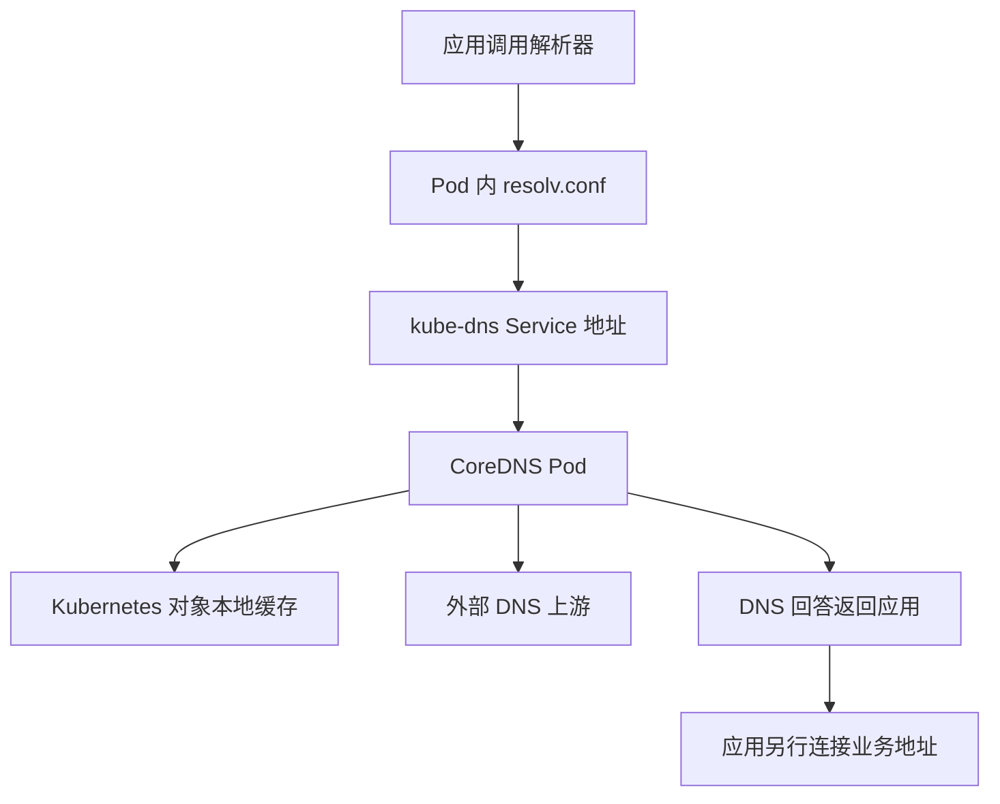
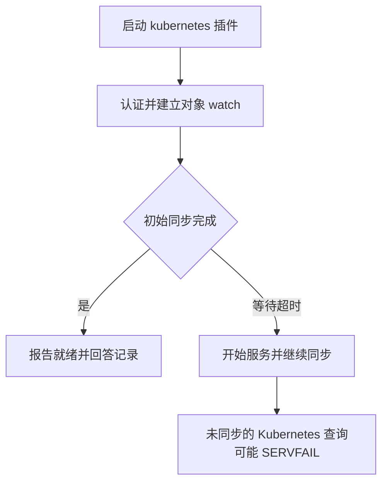
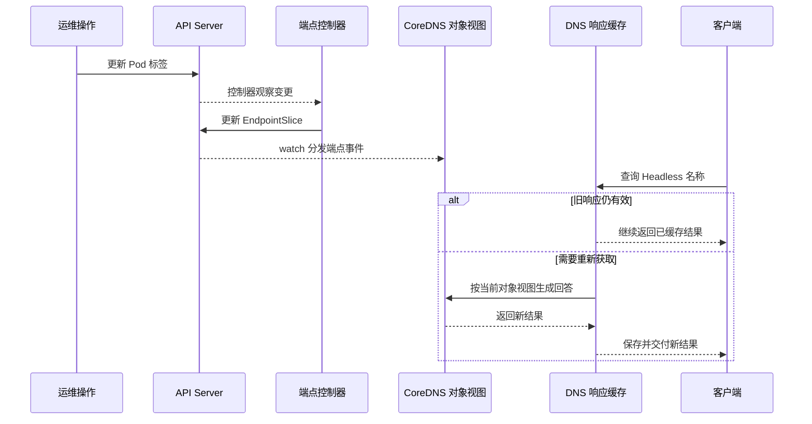
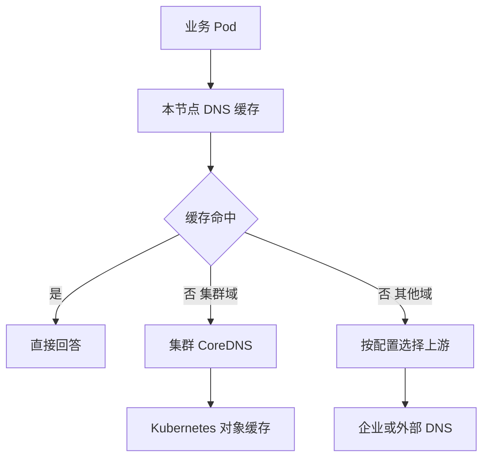

# CoreDNS Kubernetes DNS 实践 学习笔记

## 第 1 章 · 沿着 Pod 请求找到 DNS 服务

### 连接 Pod 配置、Service 与 CoreDNS
<!-- src: https://github.com/kubernetes/website/blob/release-1.34/content/en/docs/tasks/administer-cluster/dns-custom-nameservers.md; https://github.com/kubernetes/website/blob/release-1.34/content/en/docs/concepts/services-networking/dns-pod-service.md -->

本篇的 Kubernetes 行为依据官方 `release-1.34` 文档，插件语法依据 CoreDNS v1.12.4。两者是学习资料基线，并不表示 Kubernetes 1.34 一定安装该 CoreDNS 版本。托管集群、安装工具、CNI 与 DNS 插件都可能改变实际部署。

#### DNS 请求与业务请求是两条链路

普通 ClusterFirst Pod 中，kubelet 生成解析器配置，应用解析器据此选择 DNS 服务器。常见集群通过名为 `kube-dns` 的 Service 暴露 CoreDNS Pod；这个 Service 名是兼容入口，并不能用来判断后端仍是旧 kube-dns 实现。



图示为未引入 NodeLocal 的常见路径；Service 到端点的转发可由 kube-proxy 或其他数据面实现。DNS 返回 Service ClusterIP 后，应用才开始访问业务 Service。解析成功不证明业务 Endpoint 可达，业务连接失败也不能直接归因为 DNS。

#### 先读现场而不是套默认值

以下命令为只读检查，要求有对应集群权限；资源名和标签按现场调整：

```bash
kubectl -n kube-system get svc kube-dns -o wide
kubectl -n kube-system get endpointslice -l kubernetes.io/service-name=kube-dns
kubectl -n kube-system get pods -l k8s-app=kube-dns -o wide
kubectl -n kube-system get configmap coredns -o yaml
```

还要在实际失败 Pod 的容器里读取 `/etc/resolv.conf`，不要仅检查本机或节点的文件。若 nameserver 是节点本地地址，应把 NodeLocal 加入链路。`cluster.local`、DNS Service IP 和 Deployment 名称均不能写死为所有环境的事实。

练习时画出自己环境的 DNS 服务地址、端点地址、域后缀和外部上游。只要其中一项未知，就把它记为待确认，而不是把教程示例当作现场数据。

### 拆解集群 Corefile 并确认实际版本
<!-- src: https://github.com/coredns/coredns/blob/v1.12.4/plugin/kubernetes/README.md; https://github.com/coredns/coredns/blob/v1.12.4/plugin/health/README.md; https://github.com/coredns/coredns/blob/v1.12.4/plugin/cache/README.md; https://github.com/kubernetes/website/blob/release-1.34/content/en/docs/tasks/administer-cluster/dns-custom-nameservers.md -->

集群 Corefile 同时包含服务发现、转发、缓存和运行维护设置。下例改编自 Kubernetes 文档，用来解释职责；它不是可以直接覆盖任意集群的生产模板，也不代表某个安装工具的默认文件。

```text
.:53 {
    errors
    health {
        lameduck 5s
    }
    ready
    kubernetes cluster.local in-addr.arpa ip6.arpa {
        pods disabled
        fallthrough in-addr.arpa ip6.arpa
        ttl 30
    }
    prometheus :9153
    forward . /etc/resolv.conf
    cache 30
    loop
    reload
    loadbalance
}
```

#### 逐项解释职责边界

`kubernetes` 为集群域及配置的反向区域生成记录，`forward` 处理到达它的其他查询，`cache` 减少重复后端访问。反向区域的 fallthrough 允许未命中查询继续，但集群正向域不存在时通常应由 kubernetes 给出明确否定回答。

`pods disabled` 是本例主动选择的教学设置，禁用 IP 形式的 Pod 记录，不等于禁用所有 Service 与 Headless 记录。官方常见示例中的 `pods insecure` 主要用于兼容，是否保留应先查应用依赖。

`forward . /etc/resolv.conf` 读取的是 CoreDNS 进程所见文件。该文件若指回 CoreDNS 自身，会造成循环；不能仅因这是“默认示例”就认定安全。探针端口、指标监听地址还要与 Deployment 和采集配置一致。

#### 查清运行版本与实际生效配置

```bash
kubectl -n kube-system get deployment coredns -o jsonpath='{.spec.template.spec.containers[*].image}{"\n"}'
kubectl -n kube-system logs -l k8s-app=kube-dns --tail=80 --prefix=true
kubectl -n kube-system get deployment coredns -o yaml
```

检查镜像 tag/digest、容器参数、挂载路径、探针、dnsPolicy 和日志里的版本。镜像名可能被内部仓库重新打包，必要时用实际二进制版本补充确认。

Kubernetes 文档可能保留早期示例，不能把过时的 `upstream` 等字段直接复制进当前插件配置。也不要按 Corefile 书写顺序推断执行顺序，应以实际构建的 `plugin.cfg` 为依据。

## 第 2 章 · 从 Kubernetes 对象理解 DNS 记录

### 比较普通 Service、Headless 与命名端口
<!-- src: https://github.com/kubernetes/website/blob/release-1.34/content/en/docs/concepts/services-networking/dns-pod-service.md; https://github.com/coredns/coredns/blob/v1.12.4/plugin/kubernetes/README.md -->

集群 DNS 把 Kubernetes 对象映射为名称，而不是替每次请求选择具体业务 Pod。普通 Service 通常返回 ClusterIP；Headless Service 没有 ClusterIP，DNS 返回其可发布端点的地址集合。两种模式把后端选择责任放在不同位置。

| 对象 | 典型名称 | 预期内容 |
| --- | --- | --- |
| 普通 Service | `web.dns-lab.svc.cluster.local.` | Service ClusterIP |
| Headless Service | `web-headless.dns-lab.svc.cluster.local.` | 可发布 Endpoint 地址 |
| 命名端口 SRV | `_http._tcp.web.dns-lab.svc.cluster.local.` | 端口与目标名称 |
| Headless 下有主机名的端点 | `web-0.web-headless.dns-lab.svc.cluster.local.` | 对应端点 IP |

#### 将 DNS 回答与对象逐一核对

在后面的实验命名空间创建资源后，可以运行：

```bash
kubectl -n dns-lab get svc web web-headless -o wide
kubectl -n dns-lab get endpointslice -l kubernetes.io/service-name=web-headless -o yaml
kubectl -n dns-lab exec dnsutils -- dig web.dns-lab.svc.cluster.local. A
kubectl -n dns-lab exec dnsutils -- dig web-headless.dns-lab.svc.cluster.local. A
kubectl -n dns-lab exec dnsutils -- dig _http._tcp.web-headless.dns-lab.svc.cluster.local. SRV
```

双栈环境还需分别核对 A 与 AAAA。普通 Service 即使没有 ready 后端，也可能仍能解析 ClusterIP；不能把“DNS 有 IP”当作后端就绪证明。Headless 回答通常受端点 ready 状态影响，`publishNotReadyAddresses` 会改变发布边界。

#### 名称成立需要对象条件

Pod 的 `hostname`、`subdomain` 与同名 Headless Service 可以共同形成可解析的 Pod FQDN。仅给 Pod 起一个 metadata.name，不意味着任意形式的 Pod 名称都会自动成为稳定 DNS 记录。

客户端使用 Headless 时应正确处理多个地址、地址变化和连接失败。DNS 记录顺序不保证业务请求均匀分布。ExternalName 是另一类别名机制，不能用普通 ClusterIP 的排查预期套用它；需要检查 CNAME 目标及实际应用协议中的主机名行为。

### 理解对象同步、RBAC 与 Pod 记录模式
<!-- src: https://github.com/coredns/coredns/blob/v1.12.4/plugin/kubernetes/README.md; https://github.com/kubernetes/website/blob/release-1.34/content/en/docs/tasks/administer-cluster/dns-debugging-resolution.md -->

`kubernetes` 插件通过 Kubernetes API 的 list/watch 同步对象，再基于本地缓存回答请求。它不是每收到一个 DNS 查询都同步访问 API Server。因而 DNS 查询 QPS、API 请求量和对象变更量不能简单画等号。

#### 初始同步失败会影响可回答范围



基线默认初始等待上限为 5 秒，可用 `startup_timeout` 调整。增加等待时间不会修复 RBAC 拒绝或网络不通，只会改变启动阶段行为。插件通过 EndpointSlice API 观察服务端点，缺少相关权限可能影响记录生成。

```bash
kubectl -n kube-system get deployment coredns -o jsonpath='{.spec.template.spec.serviceAccountName}{"\n"}'
kubectl -n kube-system logs -l k8s-app=kube-dns --since=10m --prefix=true
kubectl get clusterrole system:coredns -o yaml
```

ClusterRole 名并非所有发行版相同，应结合实际 ServiceAccount、RoleBinding/ClusterRoleBinding 查权限。具备 impersonation 权限的管理员可再用 `kubectl auth can-i` 验证该账号对 services、namespaces、endpointslices 的 list/watch。不要仅看到 `forbidden` 就授予 cluster-admin。

#### 选择 Pod 记录模式需要考虑成本

| 模式 | IP 形式 Pod 查询行为 | 主要取舍 |
| --- | --- | --- |
| `disabled` | 不提供此类记录 | 适合没有依赖的场景 |
| `insecure` | 按查询中的 IP 生成回答 | 兼容但不验证 Pod 存在 |
| `verified` | 校验命名空间内匹配 Pod | 维护 Pod watch，增加内存成本 |

这里讨论的是类似 `10-0-0-1.ns.pod.cluster.local` 的 IP 编码名称，不能把该选项解释成“开启或关闭全部 Pod/Service DNS”。`autopath` 还依赖 verified 模式与原始客户端 Pod IP，经过 NodeLocal 或 NAT 后要重新判断是否满足条件。

初始同步完成后 API 中断时，已有本地对象数据与新变更的表现可能不同。排查时分别验证旧记录、新建记录和更新记录；`/ready` 成功不能证明最新对象都已经传播到每个实例。

### 追踪对象变更从 API 到客户端答案的传播
<!-- src: https://github.com/coredns/coredns/blob/v1.12.4/plugin/kubernetes/controller.go; https://github.com/coredns/coredns/blob/v1.12.4/plugin/kubernetes/kubernetes.go; https://github.com/coredns/coredns/blob/v1.12.4/plugin/kubernetes/ready.go; https://github.com/coredns/coredns/blob/v1.12.4/plugin/cache/handler.go; https://github.com/kubernetes/website/blob/release-1.34/content/en/docs/concepts/services-networking/dns-pod-service.md -->

一次 Kubernetes API 修改成功，只能说明相应写入已经被 API 接受，不能证明每个 CoreDNS 实例和客户端都已使用新数据。要理解传播延迟，需要把 Kubernetes 对象更新链路与 DNS 响应缓存链路连接起来。

#### 对象缓存负责生成答案，响应缓存负责复用答案

v1.12.4 的 kubernetes 插件为 Service、EndpointSlice、Namespace 等对象建立 ListWatch 和索引。初始 list 提供对象集合，后续 watch 跟踪变更；查询时通过本地对象视图寻找服务与端点，再构造 DNS 记录。Pod 对象 watch 是否启用还受插件选项影响。

| 层次 | 保存内容 | 更新依据 | 不应混淆的概念 |
| --- | --- | --- | --- |
| kubernetes 对象缓存 | Service、端点等对象的内部表示与索引 | API list/watch | 不是按 DNS TTL 定期拉取所有对象 |
| cache 响应缓存 | 某类 DNS 查询已产生的回答 | 查询填充、TTL 与刷新策略 | 不会仅因 API 对象修改就必然同步失效 |
| NodeLocal/应用缓存 | 上游答案或应用自身解析结果 | 各层策略 | 不与集中 CoreDNS 共享同一份内存 |

`kubernetes ttl 30` 控制所生成 DNS 记录的 TTL，不是 API watch 周期，也不是 EndpointSlice 控制器的刷新间隔。关闭响应缓存不等于关闭对象缓存，更不意味着每个查询都会重新读取 API。[对象控制器源码](https://github.com/coredns/coredns/blob/v1.12.4/plugin/kubernetes/controller.go)

#### 一次标签变更可能经过多次独立传播



这是单次变更的概念顺序，不保证所有事件都按某个固定时长传播。多个对象、多个 CoreDNS 副本、不同查询填充时间，都可能形成不同观察窗口。不能只把 cache TTL 当作从 API 写入到客户端更新的唯一延迟。

#### 初始未同步与运行中失去更新能力不同

初始同步尚未完成时，插件可能无法回答相关记录；运行中的 API 连接中断则可能保留已有本地对象，旧名称仍然可回答，而新增或删除对象尚不可见。已有 DNS 响应缓存还可能进一步遮蔽对象视图问题。

`ready` 通过插件暴露的就绪接口判断状态；kubernetes 的实现检查控制器是否完成初始同步。它不逐条比对 API 中所有对象是否与本地完全一致，因此“ready 成功”和“每条记录反映最新变更”不是同一个判据。

#### 用一个受控标签变更验证传播层次

先完成第三篇 `dns-lab` 实验，并确认 `web-0` 是该实验专用 Pod。在管理机记录 Pod、Service、EndpointSlice；移除选择标签后比较普通 Service 与 Headless 回答，再恢复标签：

```bash
kubectl -n dns-lab get pod web-0 -o wide
kubectl -n dns-lab get svc web web-headless -o wide
kubectl -n dns-lab get endpointslice -l kubernetes.io/service-name=web-headless -o yaml
kubectl -n dns-lab label pod web-0 app-
kubectl -n dns-lab get endpointslice -l kubernetes.io/service-name=web-headless -o yaml
kubectl -n dns-lab exec dnsutils -- dig web-headless.dns-lab.svc.cluster.local. A
kubectl -n dns-lab exec dnsutils -- dig web.dns-lab.svc.cluster.local. A
kubectl -n dns-lab label pod web-0 app=dns-lab-web --overwrite
```

以上假定集群域为 cluster.local。对象控制器更新端点与缓存过期都需要时间，应记录时间并重复观察，不能仅查询一次就判定实现错误。恢复标签后再次确认 EndpointSlice 地址和 Headless 回答恢复；若中途实验失败，也应执行恢复步骤。

普通 Service 的 ClusterIP 可继续存在，而 Headless 可发布端点集合发生变化，这正好区分“服务对象存在”与“可发布端点存在”。进一步逐个直查 CoreDNS Pod IP、节点缓存和应用解析入口，便能找出旧答案停留在哪一层。不要在生产环境阻断 API 来做此验证。

## 第 3 章 · 解释应用与命令行的解析差异

### 验证 search、ndots 与完整域名
<!-- src: https://github.com/kubernetes/website/blob/release-1.34/content/en/docs/concepts/services-networking/dns-pod-service.md -->

客户端输入 `web` 时，CoreDNS 不一定收到字面上的 `web.`。Pod 解析器会根据 search 列表和 ndots 决定尝试哪些候选名称。这一过程发生在客户端，可能产生多个查询、多个响应码，甚至 A 与 AAAA 并行请求。

#### 从容器的真实配置开始

```text
nameserver 10.96.0.10
search dns-lab.svc.cluster.local svc.cluster.local cluster.local
options ndots:5
```

这里的 IP 只是示例。常见解析器会把点数不足阈值的名字先结合 search 尝试；具体顺序、重试和并发取决于 libc、语言运行时与选项。末尾带点的绝对名称通常用于排除 search 扩展。

```bash
kubectl -n dns-lab exec dnsutils -- cat /etc/resolv.conf
kubectl -n dns-lab exec dnsutils -- dig +search web A
kubectl -n dns-lab exec dnsutils -- dig web.dns-lab.svc.cluster.local. A
kubectl -n dns-lab exec dnsutils -- dig +search example.com A
kubectl -n dns-lab exec dnsutils -- dig example.com. A
```

`dig` 默认行为与应用的 `getaddrinfo` 不相同，因此显式使用 `+search`，再结合日志或抓包看实际发出的名称。不能仅拿一次默认 dig 的成功输出证明应用端 search 行为正常。

#### 调 ndots 需要验证应用兼容性

降低 ndots 可能减少外部域名查询的 search 尝试，但也可能改变部分限定名称的查找顺序。优先在单个工作负载灰度，检查同命名空间短名、跨命名空间名、外部域名及失败路径。

观察 NXDOMAIN 增加时，应区分真实不存在的名称与 search 产生的候选失败。候选失败后最终成功，并不一定是服务故障，但会消耗查询资源。不要用固定“一个请求放大几倍”的数字概括所有应用，应从实际名称、查询类型、重试和缓存数据测量。

### 正确选择 dnsPolicy 与 dnsConfig
<!-- src: https://github.com/kubernetes/website/blob/release-1.34/content/en/docs/concepts/services-networking/dns-pod-service.md -->

`dnsPolicy` 决定基础解析配置，`dnsConfig` 在此基础上提供自定义选项。名字为 `Default` 的策略并不是 Pod 未填写字段时的默认策略；未指定通常使用 `ClusterFirst`。

| 策略 | 典型用途 | 注意事项 |
| --- | --- | --- |
| `ClusterFirst` | 普通集群工作负载 | 外部域交由集群 DNS 的上游处理 |
| `Default` | 继承节点解析配置 | 不保证能解析集群服务名 |
| `ClusterFirstWithHostNet` | hostNetwork 且需集群 DNS | 这里按 Linux 场景讨论 |
| `None` | 完全显式指定 DNS | 必须提供 dnsConfig 和 nameserver |

#### 工作负载级修改比集群级更易验证

以下为 Pod spec 片段，可用于后文实验 Pod；它不是完整 Kubernetes 资源：

```yaml
dnsPolicy: ClusterFirst
dnsConfig:
  options:
    - name: ndots
      value: "2"
```

若使用 hostNetwork，通常应明确选择 `ClusterFirstWithHostNet`；否则可能落回节点配置行为。使用 `None` 时需要自行配置 nameservers、searches 与 options，并承担集群服务名能否解析的责任。

修改控制器模板后应创建新 Pod，再读取新容器的 `/etc/resolv.conf`，同时保留旧 Pod 的对照结果。只查看 Deployment YAML 不能证明已经运行的容器采用了新设置。

#### 配置存在合并与平台限制

dnsConfig 与策略生成的配置有合并和去重过程。Kubernetes 文档对 nameserver 数量、search 数量和总长度均有约束；不同运行时也可能存在兼容差异。Windows 的解析行为与 Linux 不完全相同，不应照搬此处 search 与 hostNetwork 结论。

一个常见误区是给应用 Pod 配外部公共 nameserver 来“绕过 CoreDNS”，结果外部名称恢复而内部服务名失败。正确做法是先确定故障范围，再修复对应上游或配置，避免把单个场景的成功变成新的局部故障。

## 第 4 章 · 安全调整集群解析策略

### 配置企业域名转发并守住集群域边界
<!-- src: https://github.com/coredns/coredns/blob/v1.12.4/plugin/forward/README.md; https://github.com/coredns/coredns/blob/v1.12.4/plugin/kubernetes/README.md; https://github.com/kubernetes/website/blob/release-1.34/content/en/docs/tasks/administer-cluster/dns-custom-nameservers.md -->

企业私有区域通常有独立权威或递归上游。CoreDNS 可通过额外 Server Block 分流，让企业域查询去指定上游，其他查询继续保持原有策略。配置前需要验证从 CoreDNS 所在网络到上游的 UDP/TCP 53 连通性，而不只是管理员电脑能查到。

#### 使用明确的区域块

下面块追加到经审核的 Corefile；`192.0.2.53` 为占位地址，必须替换成实际企业 DNS：

```text
corp.example:53 {
    errors
    cache 30
    forward . 192.0.2.53
}
```

同时检查企业域是否与已有 `cluster.local`、自定义集群域或其他子域重叠。若企业上游又把该域转回集群，会产生环路。需要观察此块的指标时，再按现有采集设计加入 prometheus，不应假设根块的监控覆盖全部块。

| 查询组 | 预期责任方 | 验收重点 |
| --- | --- | --- |
| 已知集群 Service | kubernetes 插件 | 仍返回正确 ClusterIP 或端点 |
| 已知企业域名 | 企业上游 | 地址与企业权威数据一致 |
| 不存在的企业域名 | 企业上游否定回答 | 不被不相关上游伪造成功 |
| 外部域名 | 原有外部上游 | 行为保持符合原策略 |
| 反向查询 | 配置负责的插件或上游 | 不意外泄漏或循环 |

#### 不把回落当作所有问题的修复

不要为了让一个内部域名能解析，就给整个 kubernetes 插件添加无范围的 `fallthrough`。这样可能把不存在的集群服务名交给外部 DNS，模糊错误边界。更合理的做法是确定该名称属于哪个 Zone，并在相应块配置数据源。

ConfigMap 的写入、卷文件更新、Corefile 重载和缓存刷新是不同阶段。变更后应查询每个 CoreDNS 端点，并检查重载日志；单次通过 Service 的查询只覆盖其中一次路由，不能证明所有副本一致。

### 用独立实验验证 Service 记录与变更
<!-- src: https://github.com/kubernetes/website/blob/release-1.34/content/en/docs/concepts/services-networking/dns-pod-service.md; https://github.com/coredns/coredns/blob/v1.12.4/plugin/reload/README.md -->

下面实验面向已授权的测试集群，创建独立 `dns-lab` 命名空间，不修改集群 CoreDNS。需要集群能拉取示例镜像；离线环境先将镜像替换成内部等价镜像，并确保诊断镜像包含 dig。执行前确认当前 context 与命名空间不存在同名业务资源。

#### 创建普通与 Headless Service 的对照组

保存为 `dns-lab.yaml`：

```yaml
apiVersion: v1
kind: Namespace
metadata:
  name: dns-lab
---
apiVersion: v1
kind: Pod
metadata:
  name: web-0
  namespace: dns-lab
  labels:
    app: dns-lab-web
spec:
  hostname: web-0
  subdomain: web-headless
  containers:
    - name: web
      image: nginx:1.28.0-alpine
      ports:
        - containerPort: 80
      readinessProbe:
        httpGet:
          path: /
          port: 80
---
apiVersion: v1
kind: Service
metadata:
  name: web
  namespace: dns-lab
spec:
  selector:
    app: dns-lab-web
  ports:
    - name: http
      port: 80
      targetPort: 80
---
apiVersion: v1
kind: Service
metadata:
  name: web-headless
  namespace: dns-lab
spec:
  clusterIP: None
  selector:
    app: dns-lab-web
  ports:
    - name: http
      port: 80
      targetPort: 80
---
apiVersion: v1
kind: Pod
metadata:
  name: dnsutils
  namespace: dns-lab
spec:
  containers:
    - name: dnsutils
      image: registry.k8s.io/e2e-test-images/agnhost:2.39
      imagePullPolicy: IfNotPresent
  restartPolicy: Never
```

```bash
kubectl config current-context
kubectl apply -f dns-lab.yaml
kubectl -n dns-lab wait --for=condition=Ready pod/web-0 pod/dnsutils --timeout=120s
kubectl -n dns-lab exec dnsutils -- dig web.dns-lab.svc.cluster.local. A
kubectl -n dns-lab exec dnsutils -- dig web-headless.dns-lab.svc.cluster.local. A
kubectl -n dns-lab exec dnsutils -- dig web-0.web-headless.dns-lab.svc.cluster.local. A
kubectl -n dns-lab exec dnsutils -- dig _http._tcp.web-headless.dns-lab.svc.cluster.local. SRV
```

若实际集群域不是 cluster.local，应统一替换查询后缀。普通 Service 的 A 应与 ClusterIP 对应，Headless 与端点 FQDN 应与 web-0 Pod IP 对应，SRV 的端口应为 80。镜像拉取失败或 Pod 尚未就绪时，先处理这些前提，不把它们当作 DNS 算法错误。

#### 观察端点移除与恢复

在实验中移除 web-0 的 `app` 标签，观察 EndpointSlice、Headless 回答与普通 Service 回答的差异，再恢复标签。要给对象同步与 TTL 留出时间，记录改变发生到查询可见的延迟，不预设为零。

清理时仅删除本实验创建的资源：确认 `dns-lab` 仍专用于本实验后执行 `kubectl delete -f dns-lab.yaml`。该文件包含 Namespace，删除会删除其中其他资源，因此不能把共享业务资源放入这个命名空间。本系列交付仅对 YAML 做静态检查，未声称在真实集群运行过此实验。

## 第 5 章 · 引入并维护 NodeLocal DNSCache

### 解释节点缓存如何改变请求路径
<!-- src: https://github.com/kubernetes/website/blob/release-1.34/content/en/docs/tasks/administer-cluster/nodelocaldns.md -->

NodeLocal DNSCache 在每个节点运行 DNS 缓存代理，通常以 DaemonSet 部署。目的包括让缓存更接近应用、减少集中 DNS 的重复查询，以及改善部分网络路径与连接跟踪开销。它增加了一层组件和缓存，也增加了排障层次。



不能把所有 NodeLocal 未命中请求都画成必经集中 CoreDNS；非集群域的路径由 NodeLocal Corefile 决定。更改集中 CoreDNS 的企业域规则后，还要检查 NodeLocal 是否实际沿那条路径转发。

#### 对照引入前后的观测位置

| 观测点 | 引入前后可能变化 | 排查意义 |
| --- | --- | --- |
| Pod 的 nameserver | Service IP 或节点本地 IP | 确认入口 |
| 集中 CoreDNS QPS | 因本地命中而减少 | 减少不等于业务请求减少 |
| 集中 CoreDNS 所见源地址 | 可能变成缓存代理来源 | 客户端归因需调整 |
| TTL 与负缓存 | 增加一层缓存 | 新记录可见性要逐层查 |
| 故障分布 | 可能只影响特定节点 | 比较好节点和坏节点 |

官方设计可在特定路径上避开 Pod 到 DNS Service 的 DNAT/conntrack，并可把缓存到集群 DNS 的请求升级为 TCP。具体收益依赖网络实现与查询负载，应以实际路径和指标验证，不承诺固定延迟或 QPS 提升比例。

### 按网络模式验证部署、资源与回滚
<!-- src: https://github.com/kubernetes/website/blob/release-1.34/content/en/docs/tasks/administer-cluster/nodelocaldns.md -->

NodeLocal 不是“应用一个 YAML 就完成”的统一变更。应从匹配集群版本的官方清单出发，确认 kube-proxy 或替代数据面模式、集群域、DNS Service 地址、节点本地地址与现有端口占用，再替换模板变量。

#### iptables 与 IPVS 的配置不同

官方文档描述的 iptables 模式可同时监听 kube-dns Service IP 与节点本地 IP；IPVS 模式中 Service IP 已由 IPVS 接口占用，NodeLocal 只监听节点本地 IP，并需要相应调整 kubelet clusterDNS。eBPF 等其他实现应遵循对应实现文档，不能直接套这两种模式的结论。

```bash
kubectl -n kube-system get daemonset node-local-dns -o yaml
kubectl -n kube-system get configmap node-local-dns -o yaml
kubectl -n kube-system get pods -l k8s-app=node-local-dns -o wide
kubectl -n kube-system logs -l k8s-app=node-local-dns --since=10m --prefix=true
```

资源名、标签与是否允许直接编辑由实际安装方式决定。还应在测试 Pod 中读取 nameserver，并分别查询节点缓存、集中 CoreDNS 和实际上游，证明路径符合设计。

#### 资源设置与回滚要一起设计

缓存内存随条目、Server Block 和查询模式变化，不能把节点 Pod 数量直接换算成固定内存。上游慢时并发也会占用内存，可结合 forward 的 max_concurrent 设计保护。官方文档指出 OOM 后节点上的转发规则可能尚未清理，流量仍被导向不健康代理，导致短暂 DNS 中断。

灰度应选少量节点，检查重启、内存峰值、节点级错误率、命中率与集中 DNS 压力。若调整过 kubelet clusterDNS，回滚必须恢复可达的 DNS 地址并验证新 Pod；不能先删除 DaemonSet，再让所有工作负载继续查询已经消失的本地地址。

最后验证正常与故障节点、已有与新建 Pod、集群与企业域、UDP 与 TCP。只有覆盖入口配置和数据路径，才算完成 NodeLocal 变更验收。
