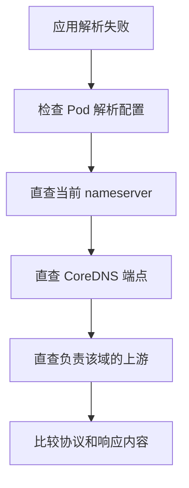
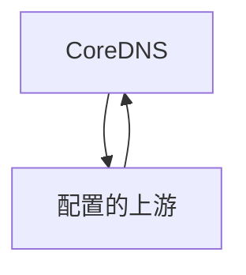
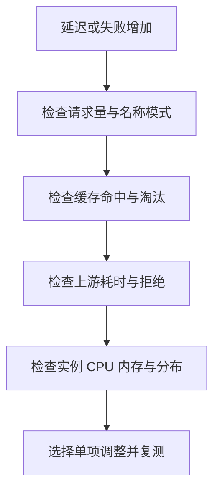
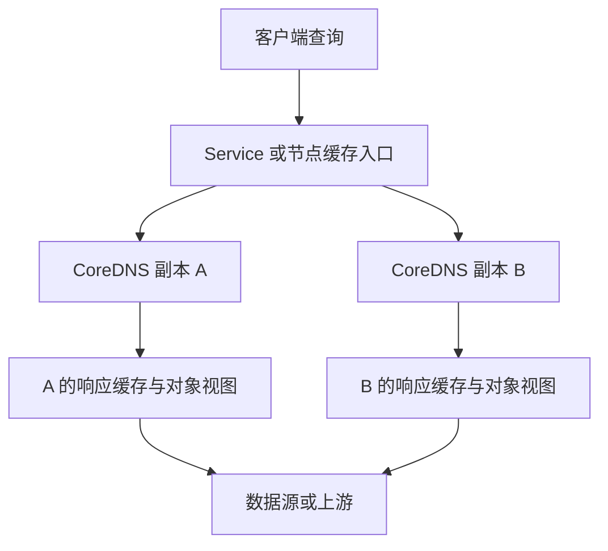

# CoreDNS 可观测性与故障排查 学习笔记

## 第 1 章 · 建立可解释的 DNS 观测体系

### 用请求量、响应码与延迟定位异常
<!-- src: https://github.com/coredns/coredns/blob/v1.12.4/plugin/metrics/README.md; https://github.com/coredns/coredns/blob/v1.12.4/plugin/forward/README.md -->

本篇围绕“现象、候选原因、验证证据、修复与复测”组织排查。指标名称以 CoreDNS v1.12.4 为基线；Prometheus 示例假定抓取目标使用 `job="coredns"`，实际环境应替换并加入集群等标签限制。先检查 `/metrics` 的真实内容，不能让空查询结果被误认为没有故障。

#### 三组指标分别回答不同问题

```promql
sum by (instance) (
  rate(coredns_dns_requests_total{job="coredns"}[5m])
)
```

它衡量进入 CoreDNS 的查询速率，不等同于用户请求速率。search、A/AAAA、重试、缓存层都会改变两者关系。先看实例分布，避免总量正常掩盖单实例倾斜。

```promql
sum by (rcode) (
  rate(coredns_dns_responses_total{job="coredns"}[5m])
)
```

响应码用于区分处理结果，但 NOERROR 不保证有目标记录，NXDOMAIN 也不一定是系统故障。将错误定义为业务所需名称的解析失败，需要额外的查询样本或合成探测。

```promql
histogram_quantile(
  0.99,
  sum by (le) (
    rate(coredns_dns_request_duration_seconds_bucket{job="coredns"}[5m])
  )
)
```

直方图先汇总 bucket 再计算分位数，不应平均多个实例已经算好的 P99。该指标反映服务器处理时间，客户端网络丢包、应用等待与多次重试未必完全包含其中。

#### 上游耗时帮助定位后半段链路

```promql
histogram_quantile(
  0.99,
  sum by (le, to) (
    rate(coredns_proxy_request_duration_seconds_bucket{
      job="coredns", proxy_name="forward"
    }[5m])
  )
)
```

若总体延迟增加而上游耗时稳定，应再检查实例 CPU、排队、日志开销及客户端路径；若集中在特定 `to`，优先直查该上游并比较网络路径。聚合标签要保留需要定位的维度，尤其多集群环境不能把同地址标签的不同上游混为一谈。

基线采用 `coredns_proxy_*` 观察 forward，旧的 `coredns_forward_requests_total` 等指标已被替代。迁移仪表盘应核对实际样本与单位，而不是只重命名标题。

### 连接缓存指标、查询日志与业务探测
<!-- src: https://github.com/coredns/coredns/blob/v1.12.4/plugin/cache/README.md; https://github.com/coredns/coredns/blob/v1.12.4/plugin/log/README.md; https://github.com/coredns/coredns/blob/v1.12.4/plugin/health/README.md; https://github.com/coredns/coredns/blob/v1.12.4/plugin/ready/README.md -->

缓存指标解释请求为什么没有到上游，日志解释某个查询发生了什么，业务探测证明用户需要的记录能否按预期返回。三者互补，任何一个单独存在都容易产生盲区。

#### 正确计算命中率

```promql
sum(rate(coredns_cache_hits_total{job="coredns"}[5m]))
/
sum(rate(coredns_cache_requests_total{job="coredns"}[5m]))
```

hits 带有 success/denial 类型，聚合后再与 requests 比较，避免标签不匹配。没有请求时比例可能是 NaN，不应自动显示为 100%。若需要每实例命中率，分子分母都按 instance 聚合；若存在多个集群，同时保留集群维度。

| 信号 | 可疑变化 | 需要进一步确认 |
| --- | --- | --- |
| `coredns_cache_evictions_total` | 淘汰增加 | 容量、唯一名称数量、分片压力 |
| `coredns_cache_served_stale_total` | 旧答案增加 | 上游故障与新鲜度要求 |
| `coredns_forward_max_concurrent_rejects_total` | 并发拒绝增加 | 上游慢或限制偏低 |
| `coredns_reload_failed_total` | 重载失败增加 | 配置是否仍停留在旧版本 |

命中率突然提高也可能是客户端不断重试相同失败名称。需要结合响应码、否定缓存比例和业务请求结果解释。

#### 用限时日志连接到具体请求

在受控排查窗口使用 Server Block 内片段：

```text
log example.test {
    class denial error
}
```

`errors` 记录处理错误，但 NXDOMAIN 这类有效 DNS 回答不一定产生 errors 日志。`log` 可记录名称、类型、返回码和耗时；多实例取日志时加实例前缀，并注意时间范围。日志含内部域名与客户端地址，分享证据时应脱敏。

业务探测至少包括一个已知集群名、一个企业名、一个外部名和一个预期不存在的名，检查返回码、记录与延迟。`health`/`ready` 作为另一层运行状态，不能代替这些探测。公开域名解析成功，也不能证明集群对象同步正常。

## 第 2 章 · 按故障范围组织排查

### 从客户端到后端逐层隔离超时
<!-- src: https://github.com/kubernetes/website/blob/release-1.34/content/en/docs/tasks/administer-cluster/dns-debugging-resolution.md; https://github.com/coredns/coredns/blob/v1.12.4/plugin/forward/README.md -->

超时只说明客户端没有在期限内收到可用响应，不能直接定位到 CoreDNS。先确定影响范围：所有 Pod 还是单个 Pod、所有节点还是某个节点、所有域名还是某个后缀、UDP 还是 TCP、持续还是间歇。

#### 以同一请求逐层比较



测试工具应运行在失败工作负载所在网络位置，或明确说明与它的差异。以下命令在已具备 dig 的测试 Pod 内执行，需填入现场值：

```bash
DNS_IP='填写Pod实际nameserver'
COREDNS_IP='填写某个CoreDNS端点IP'
UPSTREAM_IP='填写该域实际上游IP'
QUERY_NAME='填写待查完整域名并保留尾点'
dig "@$DNS_IP" "$QUERY_NAME" A +time=2 +tries=1
dig "@$COREDNS_IP" "$QUERY_NAME" A +time=2 +tries=1
dig "@$UPSTREAM_IP" "$QUERY_NAME" A +time=2 +tries=1
dig "@$DNS_IP" "$QUERY_NAME" A +tcp +time=2 +tries=1
```

占位内容必须替换。若上游只允许 CoreDNS 出站访问，测试 Pod 直查失败不构成上游不可用的证据；需要从等价授权网络位置验证。

#### 让每个对照缩小一个范围

| 对照结果 | 优先检查 | 尚未证明的事 |
| --- | --- | --- |
| Service IP 失败，端点 IP 成功 | Service 规则、端点选择、NodeLocal | 所有端点都正常 |
| 某端点失败，其他成功 | 单副本配置、节点与进程 | 集群整体配置一致 |
| CoreDNS 失败，上游直查成功 | 分流、缓存、转发源地址与策略 | 两者使用同一网络路径 |
| UDP 失败，TCP 成功 | UDP 策略、丢包、MTU、连接跟踪 | DNS 应长期强制 TCP |
| dig 成功，应用失败 | 运行时缓存、search、重试、实际名称 | 应用查询与 dig 相同 |

先保存故障现场，再决定是否重启。重启可能暂时清空缓存或改变端点，容易让问题消失却丢失原因；必要的止损动作也应记录前后差异。

### 区分 NXDOMAIN、NODATA、SERVFAIL 与 REFUSED
<!-- src: https://github.com/coredns/coredns/blob/v1.12.4/plugin/log/README.md; https://github.com/coredns/coredns/blob/v1.12.4/plugin/forward/README.md; https://github.com/coredns/coredns/blob/v1.12.4/plugin/kubernetes/README.md; https://github.com/coredns/coredns/blob/v1.12.4/plugin/file/README.md -->

这几种结果代表不同语义，不能统一叫“DNS 不通”。NXDOMAIN 是名称不存在，NODATA 是名称存在但无请求类型的记录，SERVFAIL 是解析未完成，REFUSED 表示处理被拒绝。客户端超时则根本没有拿到可解释的响应。

#### 用权威 Zone 建立错误码直觉

复用第二篇 file 实验，保留只有 A 的 `api.example.test.`：

```bash
dig @127.0.0.1 -p 1053 api.example.test. A
dig @127.0.0.1 -p 1053 api.example.test. AAAA
dig @127.0.0.1 -p 1053 missing.example.test. A
```

预期依次是有 A 的 NOERROR、无 AAAA 的 NOERROR、NXDOMAIN。记录 AUTHORITY 与 SOA，可以进一步理解否定缓存。不要只用 `+short`，因为它会让后两种输出都看起来像“什么都没有”。

| 结果 | 候选原因 | 下一条证据 |
| --- | --- | --- |
| NXDOMAIN | 名称拼错、命名空间错、未创建对象 | 直接权威查询或对象清单 |
| NODATA | 只有另一个地址族或记录类型 | 查询 A/AAAA 和已知类型 |
| SERVFAIL | 上游失败、初始同步未完成、模板错误 | errors、ready、API 日志 |
| REFUSED | 上游策略、并发限制、显式模板 | 上游直查和拒绝计数 |

#### 不以响应码替代根因

Kubernetes 中同一个 SERVFAIL，可能来自上游，也可能来自对象初始同步；应比较集群域与外部域。forward 的健康检查收到错误响应仍可能视为健康，因此不能用“健康上游数量正常”排除上游逻辑故障。

恢复后再次运行同一查询矩阵，特别验证之前失败的记录类型和源网络位置。仅新增一个能成功的测试域名，不等于原问题解决。

## 第 3 章 · 处理常见解析故障

### 排查内部正常但外部失败与转发环路
<!-- src: https://github.com/coredns/coredns/blob/v1.12.4/plugin/loop/README.md; https://github.com/coredns/coredns/blob/v1.12.4/plugin/forward/README.md; https://github.com/kubernetes/website/blob/release-1.34/content/en/docs/tasks/administer-cluster/dns-debugging-resolution.md -->

集群服务名正常而外部域失败，说明 Kubernetes 数据源至少对已测名称可用，但没有证明外部转发路径正常。候选原因包括错误上游、出站策略、上游拒绝、CoreDNS 所见 resolv.conf 异常或转发环路。

#### 对比 Corefile 与上游来源

```bash
kubectl -n kube-system get configmap coredns -o yaml
kubectl -n kube-system get deployment coredns -o yaml
kubectl -n kube-system logs -l k8s-app=kube-dns --since=15m --prefix=true
```

若 forward 使用 `/etc/resolv.conf`，应获取 CoreDNS 容器实际看到的内容。官方镜像通常没有 shell 或 cat，不能把 `kubectl exec ... -- cat` 失败误判成 DNS 故障；可用经过批准的诊断容器或节点侧容器排查方法确认文件、挂载和网络命名空间。

使用 systemd-resolved 的节点可能有指向 `127.0.0.53` 的 stub 文件。Pod 中的回环地址属于 Pod 自己的网络命名空间，不能直接当作节点本地 DNS 服务使用。应核对 kubelet resolvConf 与真实上游文件路径，路径随发行版变化，不能机械替换所有节点。

#### loop 的能力范围有限

`loop` 在启动阶段发送 HINFO 探测，若看到探测循环超过阈值会终止进程。它主要检测启动时已经存在的简单静态环路，不是持续运行、覆盖所有类型与域的通用图检测器。



看到 `Loop ... detected` 后，应沿 forward 链找到返回自身的边，而不是删除 loop 插件压住报错。删除检测器可能使 CPU、内存和请求量持续放大。

修复要分别验证：CoreDNS 能稳定启动、外部域 UDP/TCP 查询成功、节点和 Default 策略 Pod 的 DNS 同样正确。只把 CoreDNS 上游临时改成公共 DNS，可能让企业域失败，也没有修复其他 Pod 继承错误文件的问题。

### 用 systemd-resolved 场景完成环路修复与回滚
<!-- src: https://github.com/coredns/coredns/blob/v1.12.4/plugin/loop/README.md; https://github.com/kubernetes/website/blob/release-1.34/content/en/docs/tasks/administer-cluster/dns-debugging-resolution.md; https://kubernetes.io/docs/tasks/administer-cluster/kubelet-config-file/; https://kubernetes.io/docs/tasks/debug/debug-cluster/crictl/; https://github.com/containerd/containerd/blob/v1.7.24/pkg/cri/server/container_status.go -->

本例限定为自管测试集群：Ubuntu 节点使用 systemd-resolved、kubeadm 管理 kubelet、containerd 提供 CRI；CoreDNS 为 Deployment，采用 `dnsPolicy: Default`，其 `forward . /etc/resolv.conf` 意外继承了含 `127.0.0.53` 的 stub 文件。若实际部署不符合这些条件，应先调整诊断分支，不能直接执行修复命令。

所有 `kubectl` 命令在管理机执行；`systemctl`、`crictl` 和配置文件操作在选中的 Linux 节点执行。节点已安装并配置能访问 containerd 的 crictl，以及 jq；不同 CRI 的 inspect 扩展字段可能不同。以下内容是待在测试集群执行的操作示例，本系列没有实际改动任何节点。

#### 先确认故障 Pod、节点与实际解析文件

在管理机选择一个故障副本，不要直接选择标签查询结果的第一项：

```bash
kubectl config current-context
kubectl -n kube-system get pods -l k8s-app=kube-dns -o wide
DNS_POD='替换为故障CoreDNS的Pod名称'
DNS_NODE=$(kubectl -n kube-system get pod "$DNS_POD" -o jsonpath='{.spec.nodeName}')
printf '故障节点: %s\n' "$DNS_NODE"
kubectl -n kube-system get pod "$DNS_POD" -o jsonpath='{.spec.dnsPolicy}{"\n"}'
kubectl -n kube-system logs "$DNS_POD" -c coredns --previous --tail=100
kubectl -n kube-system get configmap coredns -o yaml
```

`--previous` 用于看上一次退出的容器；若没有历史实例，改查当前日志。预期证据是 `Loop ... detected` 与 forward 的实际目标来源，不能仅凭 CrashLoopBackOff 判断环路。

通过既有运维入口登录 `$DNS_NODE` 后，在节点终端重新设置相同 Pod 名，查询其容器挂载。下面读取的是 containerd 保存的容器 OCI 配置中 `/etc/resolv.conf` 的宿主机源文件，即使 CoreDNS 镜像没有 cat，也不需要向业务容器安装工具：

```bash
DNS_POD='替换为同一个故障CoreDNS的Pod名称'
sudo crictl pods --name "$DNS_POD" --namespace kube-system
# 根据列表核对完整 Pod 名与命名空间后填写对应 ID
DNS_SANDBOX='替换为对应Pod的sandbox ID'
sudo crictl ps -a --pod "$DNS_SANDBOX" --name coredns
DNS_CONTAINER='替换为对应CoreDNS容器ID'
DNS_RESOLV_SOURCE=$(sudo crictl inspect "$DNS_CONTAINER" |
    jq -r '.info.runtimeSpec.mounts[]? | select(.destination == "/etc/resolv.conf") | .source')
if [ -n "$DNS_RESOLV_SOURCE" ] && [ "$DNS_RESOLV_SOURCE" != null ]; then
    sudo cat -- "$DNS_RESOLV_SOURCE"
else
    printf '未找到预期挂载字段 请核对运行时与容器 不要猜测文件路径\n' >&2
fi
readlink -f /etc/resolv.conf
cat /etc/resolv.conf
sudo cat /run/systemd/resolve/resolv.conf
sudo systemctl cat kubelet
ps -C kubelet -o args=
```

不要修改 `DNS_RESOLV_SOURCE` 指向的运行时文件，它属于现有 Pod 的配置产物。对照三份文件：节点 `/etc/resolv.conf` 是否为 stub、CoreDNS 容器挂载是否含回环 nameserver、systemd-resolved 的上游文件是否列出真实 DNS。运行时垃圾回收后旧容器记录可能已消失，需要选仍存在的实例重新取证。

回环地址只是线索。还必须确认 CoreDNS 的监听与转发确实形成返回自身的路径；对于 hostNetwork 等不同拓扑，`127.0.0.53` 的含义可能不同。也要排除真实上游再次把该域转回集群的间接环路。

#### 验证真实上游后修改 kubelet 的配置来源

本例要求 kubelet 由 `--config=/var/lib/kubelet/config.yaml` 加载配置，且命令行没有 `--resolv-conf` 覆盖；命令行参数可以覆盖配置文件，发现覆盖时应通过实际安装工具的参数入口修复。若文件路径不同、配置由托管服务生成，停止套用本例路径。

先在节点用实际企业上游与已知域名直查 UDP/TCP。不要把教程中的公共 DNS 当成企业域的替代品：

```bash
DNS_UPSTREAM='替换为上游文件中的真实DNS地址'
DNS_KNOWN_NAME='替换为该上游应能回答的完整域名并带尾点'
dig "@$DNS_UPSTREAM" "$DNS_KNOWN_NAME" A +time=2 +tries=1
dig "@$DNS_UPSTREAM" "$DNS_KNOWN_NAME" A +tcp +time=2 +tries=1
DNS_BACKUP=$(sudo mktemp -d /var/tmp/kubelet-dns.XXXXXX)
sudo cp -a /var/lib/kubelet/config.yaml "$DNS_BACKUP/config.yaml"
printf '记录这个备份目录: %s\n' "$DNS_BACKUP"
sudoedit /var/lib/kubelet/config.yaml
```

在现有 KubeletConfiguration 顶层把原 `resolvConf` 修改为下列值；若没有则增加一次，不要新增第二个同名键，也不要覆盖文件里的其他设置：

```yaml
resolvConf: /run/systemd/resolve/resolv.conf
```

该上游文件必须存在、包含适用的非回环 DNS，且上游不指回集群。修改的是新建 Pod 的 DNS 基础配置来源，不是关闭 systemd-resolved，也不是强行改写所有工作负载的 nameserver。

```bash
sudo systemctl restart kubelet
sudo systemctl is-active kubelet
sudo journalctl -u kubelet --since '5 minutes ago' --no-pager
```

如果 kubelet 未恢复 active，或出现配置解析错误，应先恢复备份，不继续删除 DNS Pod。一个节点通过后再处理其他受影响节点；生产环境需结合可用副本和维护策略安排，避免同时重启所有节点服务。

#### 重建受影响实例并验证新旧 Pod 差异

kubelet 配置变化不会保证已有 Pod 的解析文件自动更新。管理机先确认其他 DNS 副本仍可用、故障 Pod 属于会补建副本的控制器，再仅重建目标故障 Pod：

```bash
kubectl -n kube-system get deployment coredns
kubectl -n kube-system get pods -l k8s-app=kube-dns -o wide
kubectl -n kube-system delete pod "$DNS_POD"
kubectl -n kube-system get pods -l k8s-app=kube-dns -o wide
```

若只有一个副本，重建会中断 DNS，应在测试环境或明确维护窗口执行。新副本可能调度到其他节点；它恢复正常不能单独证明原节点已修好。记录新 Pod 的节点、实际挂载文件与日志，必要时使用受控测试副本验证原节点。

在已修复节点创建一个独立的 Default 策略探测 Pod，直接检验新建 Pod 继承的解析配置。管理机沿用前面得到的 `DNS_NODE`，确认 `dns-repair-check` 名称未被其他工作占用：

```bash
kubectl -n default run dns-repair-check \
    --image=registry.k8s.io/e2e-test-images/agnhost:2.39 \
    --restart=Never \
    --overrides="{\"spec\":{\"nodeName\":\"$DNS_NODE\",\"dnsPolicy\":\"Default\"}}"
kubectl -n default wait --for=condition=Ready pod/dns-repair-check --timeout=120s
kubectl -n default exec dns-repair-check -- cat /etc/resolv.conf
```

用它查询一个已知企业域、一个允许访问的外部域；Default 策略未必能够解析集群域，所以集群 Service 名应从现有 ClusterFirst 测试 Pod 验证，例如第三篇的 `dns-lab/dnsutils`：

```bash
# 先在管理机设置实际企业域名
DNS_KNOWN_NAME='替换为已知完整企业域名并带尾点'
kubectl -n default exec dns-repair-check -- dig "$DNS_KNOWN_NAME" A
kubectl -n default exec dns-repair-check -- dig "$DNS_KNOWN_NAME" A +tcp
kubectl -n dns-lab exec dnsutils -- dig kubernetes.default.svc.cluster.local. A
```

最后一条以已创建该测试 Pod、集群域为 cluster.local 为前提；按现场替换。逐个直查 CoreDNS 端点验证企业域、外部域和集群域，确认不再重启，而不是只经过 Service 查询一次。已有 Default 策略业务 Pod 若仍保留旧解析文件，应按其控制器滚动重建并逐批验证。

#### 回滚恢复的是配置和工作负载状态

如果改动引入新问题，在该节点记录好的备份目录中恢复原配置，然后重启 kubelet：

```bash
DNS_BACKUP='替换为前面打印并保存的备份目录'
sudo cp -a "$DNS_BACKUP/config.yaml" /var/lib/kubelet/config.yaml
sudo systemctl restart kubelet
sudo systemctl is-active kubelet
sudo journalctl -u kubelet --since '5 minutes ago' --no-pager
```

回滚文件不保证已有 Pod 自动恢复原 DNS 设置；对本次变更后创建的测试副本及受影响工作负载，按原发布方式重建并复测。在管理机清理本例新建的探测 Pod：`kubectl -n default delete pod dns-repair-check`。

若原配置本身造成环路，恢复原文件只代表撤销本次变更，不代表业务恢复。此时继续保持流量由已验证健康的副本承担，重新定位上游与配置来源，不能删除 loop 插件作为“修复”。本案例没有修改 CoreDNS ConfigMap；若现场还做过临时上游覆盖，需另行回滚该配置并验证最终链路。

### 排查短名称失败与记录更新不及时
<!-- src: https://github.com/kubernetes/website/blob/release-1.34/content/en/docs/concepts/services-networking/dns-pod-service.md; https://github.com/coredns/coredns/blob/v1.12.4/plugin/cache/README.md; https://github.com/coredns/coredns/blob/v1.12.4/plugin/reload/README.md; https://github.com/coredns/coredns/blob/v1.12.4/plugin/file/README.md; https://github.com/coredns/coredns/blob/v1.12.4/plugin/hosts/README.md -->

短名称失败通常涉及客户端 search 与命名空间；旧记录通常涉及数据同步或某一层缓存。它们可以同时出现，但应分开实验，否则一次修改 ndots 加重启 DNS 后，很难判断哪个动作起了作用。

#### 短名称与绝对名称对照

在实际失败容器或等价诊断环境中，读取 `/etc/resolv.conf`，再比较：

```bash
dig +search web A
dig web.dns-lab.svc.cluster.local. A
```

若绝对名称成功而短名称失败，检查所在命名空间、search 列表、dnsPolicy 和应用解析库。若 `web` 实际在其他命名空间，应使用相应名称而不是把全局 DNS 调成特殊规则。若两个都失败，再回到记录是否存在和请求路径。

#### 从数据源逐层向客户端查旧值

| 层次 | 应检查内容 | 常见误区 |
| --- | --- | --- |
| 区域文件 | 记录、origin、SOA serial | 只修改 A 不递增 serial |
| hosts | 实际文件、内联覆盖、扫描周期 | 修改了未挂载的宿主机路径 |
| Kubernetes | Service、EndpointSlice、对象同步 | 把旧缓存当作实时 API 数据 |
| Corefile | ConfigMap 投影、重载成功日志 | API 写入成功等同于进程生效 |
| DNS 缓存 | 剩余 TTL、denial、stale | 仅重启一个副本就宣称清空 |
| 应用缓存 | 运行时策略、连接池 | dig 新值等同于应用已切换 |

例如新建 Service 后仍 NXDOMAIN：先确认对象和 EndpointSlice 的条件，再直查每个 CoreDNS 端点，最后比较 NodeLocal 和应用入口。若集中 DNS 已能返回新记录而节点缓存仍否定，应该处理该层的缓存可见性窗口，而不是继续编辑 Service。

修复后保存至少一组“数据源状态、直查回答、客户端回答”的时间对应关系。清缓存可以是实验手段，但必须说明清的是哪一层；不要写成“清理 DNS 缓存”这样无法执行和复验的动作。

## 第 4 章 · 用证据进行容量与性能调整

### 区分请求放大、上游变慢与实例过载
<!-- src: https://github.com/coredns/coredns/blob/v1.12.4/plugin/forward/README.md; https://github.com/coredns/coredns/blob/v1.12.4/plugin/cache/README.md; https://github.com/coredns/coredns/blob/v1.12.4/plugin/health/README.md; https://github.com/coredns/coredns/blob/v1.12.4/plugin/metrics/README.md -->

DNS QPS 上升可能来自业务增长，也可能来自 search 扩展、无缓存重试、随机域名或转发环路。增加副本只改变部分资源供给，并不自动减少客户端放大，也不修复慢上游。

#### 用因果链选择检查顺序



| 证据组合 | 倾向解释 | 优先动作 |
| --- | --- | --- |
| QPS 高、唯一名称高、命中低 | 查询分散或随机名称 | 找客户端与名称来源 |
| QPS 高、否定缓存命中高 | 重试或 search 候选失败 | 对比应用请求模式 |
| QPS 稳定、上游延迟高、并发拒绝高 | 慢上游拉高在途请求 | 定位上游与网络 |
| 上游正常、进程 CPU 高、查询日志巨大 | 本地开销 | 限时降低日志并对照 |
| 单副本异常、其他正常 | 分布倾斜或节点问题 | 按实例排查而非看总量 |

#### 估算仅用于提出实验假设

平均在途请求近似 `到达速率 × 平均停留时间`。上游平均耗时从 10ms 变成 200ms，即使 QPS 不变，也可能显著增加 forward 并发和内存需求。这个模型不描述峰值、重试和长尾，所以不能直接生成生产资源配额。

`coredns_health_request_duration_seconds` 是进程内部自检延迟，可辅助观察过载，但不是业务查询 P99。扩容还会创建冷缓存；滚动发布或重启全部副本可能短时增加上游负载。评估时保留足够的健康容量，并分别观察预热前后。

### 从副本局部状态理解答案差异与扩容代价
<!-- src: https://github.com/coredns/coredns/blob/v1.12.4/plugin/cache/cache.go; https://github.com/coredns/coredns/blob/v1.12.4/plugin/kubernetes/controller.go; https://github.com/coredns/coredns/blob/v1.12.4/plugin/reload/README.md; https://github.com/kubernetes/website/blob/release-1.34/content/en/docs/tasks/administer-cluster/nodelocaldns.md -->

多个 CoreDNS 副本通常独立运行各自的配置、对象视图、响应缓存和上游连接状态。增加副本可以增加处理入口和资源，但不等于建立一份共享缓存，也不保证任意时刻所有副本对同一查询都观察到完全相同的数据。

#### 先区分合法的短暂差异与配置错误



若 A 较早缓存了某条记录、B 尚未缓存，数据源变更后，A 可能在允许的 TTL 窗口内给旧答案，B 查询后端则拿到新答案。即使地址相同，剩余 TTL 也可能不同。另一方面，持续超过预期窗口的不同答案，可能来自配置未同步、不同上游数据视图或某副本对象同步异常，不能都归为“正常缓存”。

| 差异 | 首先核对 | 不能直接判定 |
| --- | --- | --- |
| IP 一致但 TTL 不同 | 填充时刻、缓存层与剩余 TTL | 存在错误记录 |
| 同名返回不同 IP | 权威变更、配置、对象视图、上游 | 一定是负载均衡正常行为 |
| 某副本一直失败 | 该实例的网络、配置与后端状态 | 扩容必然能修复 |
| 重启后上游 QPS 上升 | 冷缓存、连接重建与请求分布 | 业务访问量突然增加 |

loadbalance 改变回答记录顺序，与 Service 把请求送到不同 CoreDNS 副本是两层机制；应用可能还保留连接池，不能从 DNS 记录顺序推导实际业务连接比例。

#### 使用同一请求逐个端点建立对照

先列出 DNS Pod 和 Service 的 EndpointSlice，确认正在服务的副本，再从有权限直达这些端点的测试 Pod 查询。以下示例在第三篇的诊断 Pod 内执行，并替换为实际两个端点 IP：

```bash
DNS_A='替换为第一个CoreDNS的Pod IP'
DNS_B='替换为第二个CoreDNS的Pod IP'
DNS_NAME='web-headless.dns-lab.svc.cluster.local.'
date -u
dig "@$DNS_A" "$DNS_NAME" A +time=2 +tries=1
dig "@$DNS_B" "$DNS_NAME" A +time=2 +tries=1
```

固定名称、类型、协议和源网络位置，记录两次时间、RCODE、地址集合及 TTL，再与对象状态和配置版本对应。若查询经过 NodeLocal 或 Service，就不能声称已经确定由某个副本回答；逐端点对照正是为了减少这一变量。

本地也可以用两个前端进程、同一个 file 上游模拟独立缓存：先只预热 A，更新区域记录与 serial，直查上游确认新值后再查 A/B。预期 A 可暂时保留旧值，而未预热的 B 取得新值；TTL 到期后两者收敛。该实验只模拟缓存局部性，不模拟 Kubernetes watch 或 Service 数据面。

#### 扩容收益依赖缓存局部性与实际瓶颈

新增副本刚启动时，缓存和连接通常需要重新建立；Kubernetes 对象视图也需要初始同步。扩容可能分担 CPU，也可能在预热阶段增加上游请求。若主要瓶颈是外部上游延迟，增加 DNS 副本未必改善最终延迟，还可能把更多并发送到同一个瓶颈。

每副本维护相应缓存和对象状态，增加副本还会增加总体内存需求及对象监听开销。NodeLocal 将部分缓存移动到节点，可减少集中查询，但会增加节点级状态与故障面，不能只以集中 CoreDNS QPS 下降衡量成功。

因此变更前后应同时比较每副本请求分布、缓存命中、上游交换量、资源与客户端错误率，并分别记录冷启动和稳定阶段。将 readiness、滚动更新和保留健康容量配合使用；共享 ConfigMap 的 reload 抖动不能替代真正的受控灰度。

### 设计可比较的压测与故障实验
<!-- src: https://github.com/coredns/coredns/blob/v1.12.4/plugin/forward/README.md; https://github.com/coredns/coredns/blob/v1.12.4/plugin/cache/README.md; https://github.com/coredns/coredns/blob/v1.12.4/plugin/metrics/README.md -->

有效性能实验需要固定版本、配置、硬件、网络和请求分布。只记录“每秒能跑多少条 dig”无法推导服务容量，因为客户端进程创建、串行等待和名称重复度都影响结果。

#### 先定义请求集与验收条件

| 场景 | 请求设计 | 衡量内容 |
| --- | --- | --- |
| 热缓存 | 重复少量已知名称 | 命中后延迟与吞吐 |
| 冷缓存 | 控制的未缓存名称 | 后端处理成本 |
| 否定查询 | 已知不存在名称 | 否定缓存与失败语义 |
| 混合负载 | 按实际类型与热点比例 | 接近业务的整体行为 |
| 上游故障 | 停止一个本地上游 | 切换延迟、响应码、恢复 |
| 协议对照 | UDP 与 TCP 分开 | 网络与连接成本 |

只在隔离的本地或测试环境生成负载，不向公共 DNS 随机打压。若使用专门压测工具，记录工具版本、并发、目标速率与请求文件；不要把生产域名日志直接当作可公开的测试数据。

#### 低频重复查询用于观察，不用于容量结论

```bash
for n in 1 2 3 4 5; do
    date -u
    dig @127.0.0.1 -p 1053 api.example.test. A +time=2 +tries=1
    sleep 1
done
```

这个小实验适合看 TTL 递减、配置生效和恢复过程，但不是压测。容量实验应收集发送量、有效回答量、超时、错误码、P50/P95/P99、CPU、内存、缓存命中与上游耗时，并检查负载发生器自身是否先饱和。

每次只改变一项，例如缓存容量或副本数，再以相同请求集重跑。设置停止条件：错误率突增、延迟超过实验阈值或资源达到预定边界时停止。结论必须附环境和方法，不能把本机少量请求成功外推成生产容量承诺。

## 第 5 章 · 完成变更验收与故障复盘

### 用灰度、回滚与查询矩阵验证发布
<!-- src: https://github.com/coredns/coredns/blob/v1.12.4/plugin/reload/README.md; https://github.com/coredns/coredns/blob/v1.12.4/plugin/ready/README.md; https://github.com/kubernetes/website/blob/release-1.34/content/en/docs/tasks/administer-cluster/dns-custom-nameservers.md -->

DNS 是很多服务的共同依赖，配置变更应能定位、比较和撤销。保存旧文件还不够，还要知道文件如何投影、如何加载、哪些副本已生效以及怎样把流量送回旧配置。

#### 按变更类型选择验证路径

```bash
kubectl -n kube-system get configmap coredns -o yaml > coredns-configmap.before.yaml
kubectl -n kube-system get deployment coredns -o yaml > coredns-deployment.before.yaml
```

这些是现场快照，含集群元数据，适合审计和恢复参考，不应不加处理地提交公共仓库。恢复应通过实际 GitOps、Helm、托管插件或其他配置管理入口，避免控制器随后覆盖人工操作。

新配置先在同版本的独立实例或测试集群检查解析和查询行为。CoreDNS 不应被假设有一个通用 `-check` 命令；可在隔离端口启动候选配置再发查询。测试实例与生产域边界、上游权限不一致时，必须记录这个差异。

| 验收项 | 判据 |
| --- | --- |
| 配置语法与依赖 | 成功启动，文件与插件齐全 |
| 已知正向与否定查询 | RCODE、记录、TTL 符合设计 |
| UDP 与 TCP | 所需协议均可完成查询 |
| 所有副本 | 逐端点确认行为与版本 |
| 管理端点 | health、ready、metrics 可用 |
| 故障与恢复 | 上游异常和恢复符合预期 |
| 回滚 | 旧配置入口和复测步骤明确 |

#### 共享 ConfigMap 不等于逐副本灰度

如果所有 CoreDNS 副本引用同一个 ConfigMap 并启用 reload，修改它可能使所有副本陆续加载。`reload` 的 jitter 只是分散检测时间，不提供业务层灰度保证。需要真灰度时，应使用独立配置与实例，再让受控客户端查询候选端点，验证后通过既有发布流程推广。

回滚后重新检查 DNS 答案与端点，尤其监听端口变更失败可能留下 health/metrics 异常。Deployment rollout 成功也不等于所有业务域名正确，必须回到查询矩阵验收。

### 把排查过程沉淀为可复用记录
<!-- src: https://github.com/kubernetes/website/blob/release-1.34/content/en/docs/tasks/administer-cluster/dns-debugging-resolution.md; https://github.com/coredns/coredns/blob/v1.12.4/plugin/metrics/README.md; https://github.com/coredns/coredns/blob/v1.12.4/plugin/cache/README.md -->

好的复盘能说明“哪些事实支持这个根因，哪些候选被排除，哪些地方仍未知”。不要只写“重启 CoreDNS 后恢复”，因为这个动作同时改变缓存、连接、进程状态和调度位置，无法单独证明原因。

#### 一份可直接填写的记录结构

```text
事件时间与影响范围：
客户端位置与运行时：
CoreDNS 版本、配置标识、实例：
查询名称、类型、协议、目标服务器：
预期回答与实际 RCODE / ANSWER / TTL：
关键日志与指标时间窗：
候选原因及逐项验证：
确认原因与证据：
临时止损与长期修复：
复测矩阵与实际结果：
回滚步骤与执行情况：
尚未验证的环境或场景：
```

每个“根因”后至少附一条直接证据。例如“SOA serial 没有改变”需要区域文件版本与直查结果；“NodeLocal 旧否定缓存”需要集中 DNS 与节点缓存的同名同类型对照；“上游拒绝”需要上游响应与转发路径证据。

#### 区分三类验证结论

| 结论类型 | 可以说明 | 不能外推 |
| --- | --- | --- |
| 静态核对 | 文档、配置与版本语法一致 | 实际网络连通 |
| 本地功能实验 | 特定版本在回环环境的行为 | Kubernetes 与生产稳定性 |
| 集群或生产观察 | 对应时间与范围内的真实行为 | 所有版本和负载条件 |

本系列提供固定版本资料、可复制实验和明确判据。主题 README 记录本次实际执行范围；未运行的集群实验、DoT 联网与压测均保留为待实践内容，不编造结果。

完成学习后，可选择一个真实但可控的问题，按这份记录从客户端查到数据源，再回到客户端复测。能解释每一步排除了什么，比记住所有插件参数更有助于稳定运维。
